# Pipeline de IA — Proposal AI

Versão 0.1 · 2026-10-17

Relacionados: [ARCHITECTURE.md](ARCHITECTURE.md) §5–7 · [API_SPEC.md](API_SPEC.md) · exemplos em [examples/](examples/)

Responsável: Pessoa A (AI Engineering), com Pessoa B para o motor de estimativas.

---

## 1. Princípios

1. **A IA extrai e redige; não decide nem estima números.** Horas, equipe e cronograma vêm de regras determinísticas.
2. **Toda afirmação tem origem.** Cada item carrega `source_refs[]` com citação literal da transcrição. Sem citação → confiança baixa e registro em `limitations[]`.
3. **Dúvida vira pendência, não decisão.** Sugestão, hipótese ou "seria bom" nunca viram `decision.status=confirmed` nem `commitment.status=confirmed`.
4. **Saída sempre validada.** Structured Outputs (JSON Schema estrito gerado do Pydantic) + validação pós-processamento + retry com feedback.
5. **Prompts são artefatos versionados**, não strings inline.

## 2. Etapas

```mermaid
flowchart LR
    IN[Entrada] --> T{Áudio?}
    T -- sim --> TR[2. Transcrição]
    T -- não --> NORM
    TR --> NORM[2b. Normalização<br/>segments, speakers?]
    NORM --> EX[3. Extração estruturada<br/>LLM #1]
    EX --> VAL[4. Validação<br/>schema + quotes + regras]
    VAL --> GAP[5. Auditoria de lacunas<br/>LLM #2]
    GAP --> REV[6. Revisão humana]
    REV --> BUILD[7. Builder da proposta]
    BUILD --> EST[8. Motor de estimativas<br/>determinístico]
    EST --> COMP[9. Composição textual<br/>LLM #3]
    COMP --> PDF[10. PDF]
```



| # | Etapa | Módulo | Chamada externa | Tempo alvo |
|---|-------|--------|-----------------|-----------|
| 2 | Transcrição | `services/transcription/service.py` | `audio.transcriptions.create(model=OPENAI_TRANSCRIBE_MODEL, response_format="verbose_json" se suportado, timestamp_granularities=["segment"])` | ≤ 1× duração do áudio |
| 2b | Normalização | idem | — | ms |
| 3 | Extração | `services/ai_analysis/extract.py` | chat completion / responses com `response_format` = JSON Schema de `ExtractionOutput` | 20–60 s |
| 4 | Validação | `services/ai_analysis/validators.py` | — | ms |
| 5 | Auditoria de lacunas | `services/ai_analysis/gap_audit.py` | idem, schema `GapAuditOutput` | 10–30 s |
| 7 | Builder | `services/proposal/builder.py` | — | ms |
| 8 | Estimativas | `services/estimation/engine.py` | — | ms |
| 9 | Composição | `services/proposal/composer.py` | idem, schema `ProposalTextOutput` | 15–40 s |

Modelos: configuráveis por env (`OPENAI_MODEL`, `OPENAI_TRANSCRIBE_MODEL`). Padrões sugeridos no `.env.example`; **confirmar disponibilidade na hora 0** (DECISIONS H01). Temperatura baixa (0–0.2) em extração e auditoria; 0.4 na composição.

## 3. Schema da análise — `MeetingAnalysis`

Pydantic em `backend/app/schemas/analysis.py`. Exemplo completo: [examples/analysis.example.json](examples/analysis.example.json).

```python
# schemas/analysis.py  (versão 1.0)
from typing import Literal
from pydantic import BaseModel, Field

Confidence   = Literal["high", "medium", "low"]
ReviewStatus = Literal["pending", "confirmed", "edited", "rejected", "needs_clarification"]
Side         = Literal["client", "vendor", "unknown"]

class SourceRef(BaseModel):
    quote: str                      # trecho LITERAL da transcrição (≤ 300 chars)
    segment_id: str | None = None   # id do segmento, se houver
    speaker: str | None = None      # como aparece na transcrição, se houver
    start_ms: int | None = None
    end_ms: int | None = None

class ReviewableItem(BaseModel):
    id: str                         # ex.: "req_003" — estável entre revisões
    confidence: Confidence
    source_refs: list[SourceRef] = Field(default_factory=list)
    review_status: ReviewStatus = "pending"
    reviewer_note: str | None = None

class ClientNeed(ReviewableItem):
    category: Literal["problem", "business_goal", "target_audience", "constraint"]
    description: str

class Requirement(ReviewableItem):
    title: str
    description: str
    type: Literal["functional", "non_functional", "integration"]
    priority: Literal["must", "should", "could", "unknown"] = "unknown"
    module_id: str | None = None          # referência a Module.id
    depends_on: list[str] = []            # ids de outros requisitos

class Module(BaseModel):
    id: str                               # "mod_01"
    name: str
    description: str
    requirement_ids: list[str] = []
    complexity: Literal["S", "M", "L", "XL", "unknown"] = "unknown"   # entrada do motor de estimativas
    complexity_rationale: str | None = None

class Decision(ReviewableItem):
    description: str
    status: Literal["confirmed", "pending_validation"]
    agreed_by: list[str] = []             # nomes/papéis citados
    scope_effect: Literal["in_scope", "out_of_scope", "constraint", "other"] = "other"

class Commitment(ReviewableItem):
    owner: str                            # quem assumiu (nome ou papel)
    owner_side: Side
    description: str
    due_text: str | None = None           # prazo COMO DITO ("até sexta", "fim do mês")
    status: Literal["confirmed", "tentative", "conditional"]
    caveats: str | None = None            # condições/ressalvas ditas

class OpenIssue(ReviewableItem):
    type: Literal["missing_info", "vague_requirement", "contradiction", "question", "risk"]
    description: str
    impact: list[Literal["effort", "architecture", "cost", "timeline", "scope"]] = []
    suggested_question: str | None = None # pergunta para a próxima reunião
    related_ids: list[str] = []           # itens afetados

class TechSuggestion(ReviewableItem):
    category: Literal["architecture", "technology", "module", "assumption", "process"]
    description: str
    rationale: str
    risks: str | None = None
    # NUNCA tem status de decisão; é sempre "sugestão da IA"

class Participant(BaseModel):
    name: str | None = None
    role: str | None = None
    side: Side

class TranscriptMetadata(BaseModel):
    language: str | None
    duration_ms: int | None
    has_speakers: bool
    has_timestamps: bool
    source_type: Literal["audio", "text"]

class AnalysisMeta(BaseModel):
    schema_version: str = "1.0"
    prompt_version: str                   # ex.: "extract@1.2+gap_audit@1.0"
    model: str
    generated_at: str
    reviewed_by: str | None = None
    reviewed_at: str | None = None

class MeetingAnalysis(BaseModel):
    meeting_id: str
    summary: str                          # 3–6 frases, neutro
    participants: list[Participant]
    client_needs: list[ClientNeed]
    requirements: list[Requirement]
    modules: list[Module]
    decisions: list[Decision]
    commitments: list[Commitment]
    open_issues: list[OpenIssue]
    tech_suggestions: list[TechSuggestion]
    transcript_metadata: TranscriptMetadata
    limitations: list[str]                # ex.: "Transcrição sem identificação de falantes"
    review_completed: bool = False
    meta: AnalysisMeta
```

Saídas intermediárias dos LLMs são subconjuntos: `ExtractionOutput` (tudo exceto `open_issues`, `meta`, `transcript_metadata`, `review_*`) e `GapAuditOutput` (`open_issues`, `contradiction_flags: [{decision_or_requirement_id, conflicting_with_id, explanation}]`, `additional_limitations`). O orquestrador funde as duas.

Para Structured Outputs estritos: todos os campos obrigatórios no schema enviado (opcionais viram `anyOf [T, null]`), `additionalProperties: false`. Pydantic faz isso via `model_json_schema()` + ajuste em `integrations/openai/schema.py`.

## 4. Categorias e critérios de classificação

| Categoria | Entra quando… | NÃO entra quando… |
|-----------|---------------|-------------------|
| `client_needs` | Cliente descreve dor, objetivo, público, restrição. | É solução ("quero um app") — isso é `requirement`. |
| `requirements` | Alguém descreve capacidade do sistema. Prioridade só se dita explicitamente. | É ideia do fornecedor não acolhida pelo cliente — vira `tech_suggestion` ou `open_issue(question)`. |
| `decisions.confirmed` | Há concordância explícita de ambos os lados ("fechado", "ok, vamos assim", "sim, pode ser") **e** o texto suporta isso na citação. | Só um lado afirmou; linguagem condicional ("se der", "talvez", "a gente pode"). → `pending_validation`. |
| `commitments.confirmed` | Alguém diz que **vai fazer** algo, em primeira pessoa ou atribuído a si, sem condição ("eu envio a planilha amanhã"). | Linguagem futura vaga ("seria bom mandar"), condicional ("se o João aprovar, eu envio") → `conditional`; intenção ("vou tentar") → `tentative`. |
| `open_issues` | Informação ausente que afeta esforço/arquitetura/custo/prazo; termos vagos ("rápido", "integrar com tudo"); contradições; perguntas feitas e não respondidas. | Detalhe de implementação normal que a proposta pode assumir e declarar em premissas (isso vira `tech_suggestion.category=assumption`). |
| `tech_suggestions` | Qualquer recomendação originada do modelo (arquitetura, stack, módulo extra, premissa). Também ideias do fornecedor na reunião **que o cliente não confirmou**. | Nunca vira decisão/requisito sem ação humana na revisão. |

**Falantes.** Se `has_speakers=false`, o extrator só preenche `commitment.owner` quando o texto deixa óbvio ("eu, Ana, …" ou contexto claro); senão `owner="não identificado"`, `owner_side="unknown"`, `confidence="low"`, e `limitations[]` recebe nota. O prompt proíbe inventar nomes.

## 5. Prompts e responsabilidades

Arquivos em `backend/app/services/ai_analysis/prompts/`, com front-matter:
```
---
name: extract
version: 1.0
model_hint: OPENAI_MODEL
temperature: 0.1
---
```

| Prompt | Responsabilidade | Entrada | Saída (schema) |
|--------|------------------|---------|----------------|
| `extract.md` | Extrair necessidades, requisitos, módulos, decisões, compromissos, sugestões; propor `complexity` por módulo com justificativa; citar literalmente. | transcrição (texto + segmentos se houver), dados do projeto, idioma | `ExtractionOutput` |
| `gap_audit.md` | Dado transcrição + extração, listar: informações ausentes para estimar, requisitos vagos, contradições entre itens, perguntas sem resposta, riscos; sugerir pergunta para cada. Rebaixar para `pending_validation`/`tentative` decisões/compromissos sem evidência (retorna `downgrade: [{id, reason}]`). | transcrição + `ExtractionOutput` | `GapAuditOutput` |
| `compose_proposal.md` | Redigir textos das seções a partir **somente** dos itens com `review_status ∈ {confirmed, edited}` e das estimativas já calculadas. Não introduzir requisitos novos; não alterar números; marcar sugestões como sugestões. | análise revisada filtrada + `EstimateResult` + `vendor_profile` | `ProposalTextOutput` |
| `repair.md` (sufixo) | Anexado ao reenvio quando a validação falha: lista os erros Pydantic/regra e pede correção mantendo o restante. | saída anterior + erros | mesmo schema |

Regras comuns nos prompts (trecho do `extract.md`):
> - Responda no idioma da transcrição.
> - `quote` deve ser cópia literal de um trecho contínuo da transcrição (máx. 300 caracteres). Não parafraseie. Se não encontrar trecho literal, não crie o item.
> - Não classifique como `confirmed` nada que dependa de "talvez", "se", "acho que", "seria bom", "a gente pode".
> - Não invente nomes de pessoas, empresas, prazos ou valores. Prazos vão em `due_text` exatamente como ditos.
> - Sugestões suas vão em `tech_suggestions`, nunca em `decisions` ou `requirements`.

## 6. Estratégia para saídas inválidas

```
tentativa 1 → structured output
  ├─ JSON inválido / schema violado (ValidationError) → tentativa 2 com repair.md + erros
  ├─ válido mas regras de negócio falham (ver §6.1) → tentativa 2 com repair.md + lista de violações
  └─ válido → segue
tentativa 2 falha → tentativa 3 (última)
tentativa 3 falha → Meeting.status = failed, error.code = AI_OUTPUT_INVALID, error.details = violações
```
Erros de rede/5xx/429 da OpenAI: retry com backoff 1 s, 3 s, 8 s (3×) antes de `AI_PROVIDER_ERROR`.

### 6.1 Validações pós-schema (`validators.py`)
| Regra | Ação se violada |
|-------|-----------------|
| Cada `quote` ocorre na transcrição (normalizando espaços, caixa e pontuação final) | Rebaixa `confidence` para `low`, remove a `source_ref` inválida, adiciona a `limitations[]`. Se item fica sem refs **e** é `decision.confirmed` ou `commitment.confirmed` → rebaixa para `pending_validation`/`tentative`. Não reprocessa. |
| IDs únicos e referências (`module_id`, `depends_on`, `related_ids`) existem | Reprocessa (repair) |
| `decision.status=confirmed` com `confidence=low` | Rebaixa para `pending_validation` (sem reprocessar) |
| `commitment.status=confirmed` sem `owner` | Rebaixa para `tentative` |
| `summary` > 1200 chars ou vazio | Reprocessa |
| Nenhum requisito extraído de transcrição > 500 palavras | Reprocessa com dica "a transcrição contém discussão de funcionalidades" |

Tudo que o validador altera é registrado em `limitations[]` para o revisor ver.

## 7. Detecção de ambiguidades

A auditoria (`gap_audit`) é guiada por um checklist embutido no prompt — o modelo deve verificar explicitamente se a reunião responde:

1. Quem são os usuários e quantos (volume)?
2. Há sistemas existentes a integrar? Quais, com API?
3. Há dados a migrar?
4. Requisitos de autenticação/perfis?
5. Plataforma (web, mobile, ambos)?
6. Prazo ou evento-alvo do cliente?
7. Orçamento ou faixa mencionada?
8. Quem decide do lado do cliente?
9. Requisitos não funcionais (desempenho, disponibilidade, LGPD, idioma)?
10. Hospedagem/infra preferida?
11. Termos vagos usados ("simples", "rápido", "tipo o X", "integrar com tudo")?
12. Itens que um lado afirmou e o outro não respondeu?

Cada "não" vira um `OpenIssue(type=missing_info)` com `impact` e `suggested_question`. Contradições cruzam `decisions` × `requirements` × `commitments`.

## 8. Schema da proposta — `ProposalContent`

Pydantic em `backend/app/schemas/proposal.py`. Exemplo: [examples/proposal_content.example.json](examples/proposal_content.example.json). Mapeia as 16 seções do briefing.

```python
class Party(BaseModel):
    company: str; contact_name: str | None; contact_email: str | None; contact_phone: str | None

class Vendor(BaseModel):
    company: str; contact_name: str | None; contact_email: str | None; website: str | None
    is_demo_profile: bool = True

class ProposalModule(BaseModel):
    id: str; name: str; description: str
    features: list[str]
    complexity: Literal["S", "M", "L", "XL"]
    source_requirement_ids: list[str]

class ArchitectureSection(BaseModel):
    overview: str
    components: list[dict]            # {name, responsibility}
    technologies: list[dict]          # {layer, choice, rationale}
    diagram_mermaid: str | None
    is_ai_suggestion: bool = True     # SEMPRE true no MVP; renderizado com rótulo

class EstimateLine(BaseModel):
    module_id: str; profile: str      # "backend_dev", "frontend_dev", "qa", "pm", "ux", "devops"
    hours_min: int; hours_max: int
    rationale: str | None            # P1: justificativa textual

class Estimates(BaseModel):
    method: str                       # "rules_v1 + historical_demo"
    basis_label: str                  # "Base demonstrativa — projetos fictícios"
    lines: list[EstimateLine]
    totals_by_profile: dict[str, dict]  # {profile: {hours_min, hours_max}}
    total_hours_min: int; total_hours_max: int
    confidence: Confidence
    assumptions: list[str]

class TeamPhase(BaseModel):
    phase: str; duration_weeks: int
    roles: list[dict]                 # {profile, allocation_pct, count}

class SchedulePhase(BaseModel):
    name: str; duration_weeks: int; depends_on: list[str]; deliverables: list[str]

class Commercial(BaseModel):
    status: Literal["not_provided", "demo_rates", "provided"]
    currency: str | None
    hourly_rates: dict[str, float] | None
    total_min: float | None; total_max: float | None
    payment_terms: str | None; validity_days: int | None
    disclaimer: str | None            # obrigatório se demo_rates

class ProposalMeta(BaseModel):
    version: int; revision_label: str # "rascunho" | "aprovada"
    created_at: str; language: str
    source_meeting_id: str; source_analysis_prompt_version: str

class ProposalContent(BaseModel):
    schema_version: str = "1.0"
    title: str
    client: Party                     # 1 capa
    vendor: Vendor
    executive_summary: str            # 2
    business_context: str             # 3
    objectives: list[str]             # 4
    scope: dict                       # 5  {in_scope: [str], out_of_scope: [str]}
    modules: list[ProposalModule]     # 6
    requirements_and_integrations: list[dict]  # 7 {title, description, type}
    architecture: ArchitectureSection # 8
    assumptions: list[str]            # 9
    dependencies: list[str]           # 9
    exclusions: list[str]             # 9
    estimates: Estimates              # 10
    team: list[TeamPhase]             # 11
    schedule: list[SchedulePhase]     # 12
    total_weeks: int
    risks: list[dict]                 # 13 {description, mitigation}
    open_points: list[dict]           # 13 {description, question}
    commercial: Commercial            # 14
    next_steps: list[str]             # 15
    meta: ProposalMeta                # 16
```

`content_hash = sha256(json.dumps(content, sort_keys=True, ensure_ascii=False, separators=(",", ":")))`.

## 9. Estratégia de estimativas (determinística)

Arquivo de regras `services/estimation/rules.py` (dados, não lógica — ajustável sem código, T07):

```python
HOURS_BY_COMPLEXITY = {   # por módulo, faixa total mín–máx
    "S":  (24,  48),
    "M":  (60,  120),
    "L":  (140, 260),
    "XL": (300, 520),
}
PROFILE_SPLIT = {          # distribuição das horas do módulo
    "backend_dev": 0.40, "frontend_dev": 0.30, "qa": 0.15, "ux": 0.05, "pm": 0.10,
}
INTEGRATION_SURCHARGE = (16, 40)   # por requisito type=integration
NFR_SURCHARGE_PCT = 0.10           # se houver ≥ 3 requisitos não funcionais
UNCERTAINTY_PCT = {                # amplia hours_max conforme pendências de impacto effort/architecture
    0: 0.0, 1: 0.05, 2: 0.10, 3: 0.20,  # ≥3 → 0.20
}
CROSS_CUTTING = {                  # horas fixas de projeto
    "setup_devops": (24, 40), "discovery_refinement": (16, 32), "deploy_handover": (16, 24),
}
WEEKLY_CAPACITY_PER_DEV = 32       # horas produtivas/semana
```

Algoritmo (`engine.py`):
1. Para cada módulo confirmado: faixa por `complexity` (módulos `unknown` → tratados como `M` **e** gera `assumption`).
2. Soma sobretaxas de integração e RNF.
3. Aplica `UNCERTAINTY_PCT` sobre `hours_max` conforme nº de `open_issues` com impacto `effort`/`architecture` **não resolvidos** na revisão.
4. Divide por perfil via `PROFILE_SPLIT`; adiciona `CROSS_CUTTING`.
5. **Histórico (demo):** `historical.py` carrega `sample_data/historical_projects.json` (fictício, rotulado) e, por similaridade de nomes/tags de módulos, ajusta ±15% se houver ≥ 2 módulos similares; registra em `assumptions` quais projetos influenciaram.
6. Cronograma: fases fixas `Descoberta → Construção (iterações por módulo, ordenadas por dependências) → Estabilização → Implantação`; duração = horas / (devs × capacidade). Equipe sugerida: 2 devs para < 400 h, 3 para < 900 h, 4 acima.
7. `confidence`: `high` se 0 pendências de impacto e todos módulos com complexidade conhecida; `medium` se ≤ 2; senão `low`.
8. Comercial: se `include_demo_rates` → aplica `sample_data/vendor_profile.json.hourly_rates` com `status=demo_rates` e `disclaimer` fixo; senão `not_provided`.

Saída `EstimateResult` → alimenta `ProposalContent.estimates/team/schedule/commercial`. O composer de texto recebe esses números **como contexto só-leitura** e é instruído a não alterá-los (validador compara).

## 10. Limites do que pode ser inferido

| Pode inferir | Não pode inferir (vira pendência ou premissa explícita) |
|--------------|---------------------------------------------------------|
| Módulos a partir de agrupamento de requisitos | Prioridade do cliente, se não dita |
| Complexidade relativa (S–XL) com justificativa | Horas reais — vêm das regras |
| Integrações mencionadas | Existência/qualidade de API de terceiros |
| Stack sugerida (como sugestão) | Preferência do cliente por stack |
| Que um prazo foi citado | Que o prazo é compromisso do fornecedor |
| Quem falou, se há diarização | Quem falou, sem diarização e sem pista textual |
| Objetivo de negócio dito | Orçamento, valores, condições comerciais |

## 11. Testes com exemplos de reunião

Pasta `sample_data/` + `backend/tests/ai/`:

| Arquivo | Uso |
|---------|-----|
| `sample_transcript_pt.txt` | Reunião fictícia (~2.500 palavras) entre "Distribuidora Horizonte" (cliente) e software house. Contém deliberadamente: 2 decisões confirmadas, 2 pendentes, 3 compromissos (1 do cliente, 1 do fornecedor, 1 condicional), 1 contradição, 3 termos vagos, 1 sugestão do fornecedor não acolhida. |
| `sample_analysis_expected.json` | Gabarito manual (ids esperados por categoria, status esperados). |
| `sample_meeting.mp3` | Áudio da mesma reunião (gravado pela equipe, T05), 5–8 min. |
| `historical_projects.json` | 8–12 projetos fictícios com módulos, complexidade e horas "realizadas". |
| `vendor_profile.json` | Software house fictícia: nome, contato, rates demonstrativos. |

Testes (`pytest -m ai` chama a API real; `-m "not ai"` usa fixtures gravadas):
1. **Schema:** saída valida em `MeetingAnalysis`.
2. **Fidelidade:** ≥ 90% das `quote` existem na transcrição.
3. **Classificação:** itens do gabarito presentes (≥ 80%); nenhuma `tech_suggestion` do gabarito aparece em `decisions`.
4. **Contradição:** a contradição plantada aparece em `open_issues(type=contradiction)`.
5. **Rebaixamento:** o compromisso condicional não sai como `confirmed`.
6. **Determinismo da estimativa:** mesma análise → mesmos números (teste unitário puro).
7. **Composer não altera números:** `ProposalContent.estimates` idêntico ao `EstimateResult`.
8. **Repair:** fixture com saída inválida → segunda tentativa é acionada com `repair.md`.

Registrar por execução: modelo, versão de prompt, tokens, latência (`logs/ai_runs.jsonl`) — insumo para as métricas de PRODUCT_SPEC §11.
