# Pipeline de IA — Proposal AI

Versão 0.2 · 2026-10-17 · Implementação em TypeScript (ver DECISIONS D13)

Relacionados: [ARCHITECTURE.md](ARCHITECTURE.md) §5–7 · [API_SPEC.md](API_SPEC.md) · exemplos em [examples/](examples/)

Responsável: Pessoa A (AI Engineering), com Pessoa B para o motor de estimativas.

---

## 1. Princípios

1. **A IA extrai e redige; não decide nem estima números.** Horas, equipe e cronograma vêm de regras determinísticas.
2. **Toda afirmação tem origem.** Cada item carrega `source_refs[]` com citação literal da transcrição. Sem citação → confiança baixa e registro em `limitations[]`.
3. **Dúvida vira pendência, não decisão.** Sugestão, hipótese ou "seria bom" nunca viram `decision.status=confirmed` nem `commitment.status=confirmed`.
4. **Saída sempre validada.** Structured Outputs (`zodTextFormat`, JSON Schema estrito gerado do Zod) + validação pós-processamento + retry com feedback.
5. **Prompts são artefatos versionados**, não strings inline.
6. **O resumo da reunião é derivado, nunca fonte de verdade.** Ele é gerado *depois* da análise validada, referencia decisões, compromissos e pendências **por id** (sem reescrevê-los) e nunca promove uma decisão pendente a confirmada. A proposta continua sendo composta só a partir dos itens revisados — o resumo não alimenta o composer.

## 2. Etapas

```mermaid
flowchart LR
    IN[Entrada] --> T{Áudio?}
    T -- sim --> TR[2. Transcrição]
    T -- não --> NORM
    TR --> NORM[2b. Normalização<br/>segments, speakers?]
    NORM --> EX[3. Extração estruturada<br/>LLM #1]
    EX --> VAL[4. Validação<br/>schema + quotes + regras]
    VAL --> GAP[5. Auditoria de lacunas<br/>LLM #2]
    GAP --> SUM[5b. Resumo da reunião<br/>LLM #2b]
    SUM --> REV[6. Revisão humana]
    REV --> BUILD[7. Builder da proposta]
    BUILD --> EST[8. Motor de estimativas<br/>determinístico]
    EST --> COMP[9. Composição textual<br/>LLM #3]
    COMP --> PDF[10. PDF]
```



| # | Etapa | Módulo (`backend/src/`) | Chamada externa | Tempo alvo |
|---|-------|-------------------------|-----------------|-----------|
| 2 | Transcrição | `services/transcription/service.ts` | `client.audio.transcriptions.create({ file: fs.createReadStream(path), model, response_format: "verbose_json", timestamp_granularities: ["segment"] })` (se o modelo suportar; senão `"json"`) | ≤ 1× duração do áudio |
| 2b | Normalização | idem | — | ms |
| 3 | Extração | `services/aiAnalysis/extract.ts` | `client.responses.parse({ model, input, text: { format: zodTextFormat(ExtractionOutput, "extraction") } })` | 20–60 s |
| 4 | Validação | `services/aiAnalysis/validators.ts` | — | ms |
| 5 | Auditoria de lacunas | `services/aiAnalysis/gapAudit.ts` | idem, schema `GapAuditOutput` | 10–30 s |
| 5b | Resumo da reunião | `services/aiAnalysis/summarize.ts` | idem, schema `MeetingSummaryOutput` | 10–25 s |
| 7 | Builder | `services/proposal/builder.ts` | — | ms |
| 8 | Estimativas | `services/estimation/engine.ts` | — | ms |
| 9 | Composição | `services/proposal/composer.ts` | idem, schema `ProposalTextOutput` | 15–40 s |

Modelos: configuráveis por env (`OPENAI_MODEL`, `OPENAI_TRANSCRIBE_MODEL`). Padrões sugeridos no `.env.example`; **confirmar disponibilidade na hora 0** (DECISIONS H01). Temperatura baixa (0–0.2) em extração, auditoria e resumo; 0.4 na composição.

**Falha do resumo não derruba a reunião.** Se a etapa 5b falhar após as tentativas (§6), a reunião chega a `analysis_ready` com `meeting_summary = null` e uma nota em `limitations[]`; o resumo pode ser gerado depois por `POST /meetings/{id}/summary`. A análise estruturada é o que a proposta exige; o resumo é conveniência de leitura e de demonstração.

Wrapper único em `integrations/openai/client.ts`:
```ts
export async function structuredCompletion<T extends z.ZodTypeAny>(opts: {
  prompt: LoadedPrompt;            // {name, version, system, temperature}
  input: string;                   // conteúdo do usuário já montado
  schema: T; schemaName: string;
  attempt?: number;
}): Promise<{ data: z.infer<T>; usage: Usage; latencyMs: number }>
```
Faz retry com backoff em `APIConnectionError`/`RateLimitError`/5xx (1 s, 3 s, 8 s), registra `usage` e latência em `logs/ai_runs.jsonl` e lança `AiOutputInvalidError` quando `output_parsed` é `null` (recusa ou JSON inválido).

## 3. Schema da análise — `MeetingAnalysis`

Zod em `shared/src/schemas/analysis.ts`. Exemplo completo: [examples/analysis.example.json](examples/analysis.example.json).

> **Regras para compatibilidade com Structured Outputs estritos:** todo campo é obrigatório no schema enviado ao modelo — use `.nullable()` em vez de `.optional()`; sem `.default()`; sem `z.record` com chaves dinâmicas nos schemas enviados ao LLM (use arrays de pares); `z.enum` para literais. Os schemas de **persistência/API** podem ter `.default()` — por isso existem dois: `XOutput` (LLM, estrito) e `X` (API), derivados do mesmo núcleo.

```ts
// shared/src/schemas/analysis.ts  (versão 1.0)
import { z } from "zod";

export const Confidence   = z.enum(["high", "medium", "low"]);
export const ReviewStatus = z.enum(["pending", "confirmed", "edited", "rejected", "needs_clarification"]);
export const Side         = z.enum(["client", "vendor", "unknown"]);

export const SourceRef = z.object({
  quote: z.string().max(300),            // trecho LITERAL da transcrição
  segment_id: z.string().nullable(),     // id do segmento, se houver
  speaker: z.string().nullable(),        // como aparece na transcrição
  start_ms: z.number().int().nullable(),
  end_ms: z.number().int().nullable(),
});

const Reviewable = z.object({
  id: z.string(),                        // ex.: "req_003" — estável entre revisões
  confidence: Confidence,
  source_refs: z.array(SourceRef),
  review_status: ReviewStatus,           // LLM sempre devolve "pending"
  reviewer_note: z.string().nullable(),
});

export const ClientNeed = Reviewable.extend({
  category: z.enum(["problem", "business_goal", "target_audience", "constraint"]),
  description: z.string(),
});

export const Requirement = Reviewable.extend({
  title: z.string(),
  description: z.string(),
  type: z.enum(["functional", "non_functional", "integration"]),
  priority: z.enum(["must", "should", "could", "unknown"]),
  module_id: z.string().nullable(),      // referência a Module.id
  depends_on: z.array(z.string()),       // ids de outros requisitos
});

export const Module = z.object({
  id: z.string(),                        // "mod_01"
  name: z.string(),
  description: z.string(),
  requirement_ids: z.array(z.string()),
  complexity: z.enum(["S", "M", "L", "XL", "unknown"]),   // entrada do motor de estimativas
  complexity_rationale: z.string().nullable(),
});

export const Decision = Reviewable.extend({
  description: z.string(),
  status: z.enum(["confirmed", "pending_validation"]),
  agreed_by: z.array(z.string()),        // nomes/papéis citados
  scope_effect: z.enum(["in_scope", "out_of_scope", "constraint", "other"]),
});

export const Commitment = Reviewable.extend({
  owner: z.string(),                     // quem assumiu (nome ou papel)
  owner_side: Side,
  description: z.string(),
  due_text: z.string().nullable(),       // prazo COMO DITO ("até sexta")
  status: z.enum(["confirmed", "tentative", "conditional"]),
  caveats: z.string().nullable(),
});

export const OpenIssue = Reviewable.extend({
  type: z.enum(["missing_info", "vague_requirement", "contradiction", "question", "risk"]),
  description: z.string(),
  impact: z.array(z.enum(["effort", "architecture", "cost", "timeline", "scope"])),
  suggested_question: z.string().nullable(),
  related_ids: z.array(z.string()),
});

export const TechSuggestion = Reviewable.extend({
  category: z.enum(["architecture", "technology", "module", "assumption", "process"]),
  description: z.string(),
  rationale: z.string(),
  risks: z.string().nullable(),
  // NUNCA tem status de decisão; é sempre "sugestão da IA"
});

export const Participant = z.object({
  name: z.string().nullable(), role: z.string().nullable(), side: Side,
});

export const TranscriptMetadata = z.object({
  language: z.string().nullable(),
  duration_ms: z.number().int().nullable(),
  has_speakers: z.boolean(),
  has_timestamps: z.boolean(),
  source_type: z.enum(["audio", "text"]),
});

export const AnalysisMeta = z.object({
  schema_version: z.literal("1.0"),
  prompt_version: z.string(),            // "extract@1.0+gap_audit@1.0"
  model: z.string(),
  generated_at: z.string().datetime(),
  reviewed_by: z.string().nullable(),
  reviewed_at: z.string().datetime().nullable(),
});

// --- Saídas dos LLMs (estritas) ---
export const ExtractionOutput = z.object({
  summary: z.string(),
  participants: z.array(Participant),
  client_needs: z.array(ClientNeed),
  requirements: z.array(Requirement),
  modules: z.array(Module),
  decisions: z.array(Decision),
  commitments: z.array(Commitment),
  tech_suggestions: z.array(TechSuggestion),
  limitations: z.array(z.string()),
});

export const GapAuditOutput = z.object({
  open_issues: z.array(OpenIssue),
  downgrades: z.array(z.object({ id: z.string(), to: z.enum(["pending_validation", "tentative"]), reason: z.string() })),
  additional_limitations: z.array(z.string()),
});

// --- Resumo da reunião (LLM #2b, estrito) ---
export const SummaryTopic = z.object({
  title: z.string(),                     // ≤ 80 caracteres
  summary: z.string(),                   // 1–3 frases, ≤ 400 caracteres
  source_refs: z.array(SourceRef),       // ≥ 1; segment_id/start_ms preenchidos pelo validador (§6.2)
});
export const MeetingSummaryOutput = z.object({
  headline: z.string(),                  // 1 linha, ≤ 140 caracteres
  executive_summary: z.string(),         // 3–5 frases, ≤ 700 caracteres
  topics: z.array(SummaryTopic),         // 3–8 tópicos, em ordem cronológica
  key_decisions: z.array(z.string()),    // ids de decisions com status "confirmed"
  pending_decisions: z.array(z.string()),// ids de decisions com status "pending_validation"
  next_steps: z.array(z.string()),       // ids de commitments (qualquer status; a UI exibe o status)
  open_points: z.array(z.string()),      // ids de open_issues; no máximo 5, priorizados (contradição > impacto em esforço/arquitetura/prazo > custo/escopo)
});
export const SummaryMeta = z.object({
  prompt_version: z.string(),            // "summarize@1.0"
  model: z.string(),
  generated_at: z.string().datetime(),
  basis: z.enum(["analysis", "reviewed"]), // "reviewed" = só itens confirmed/edited
});
export const MeetingSummary = MeetingSummaryOutput.extend({ meta: SummaryMeta });

// --- Documento persistido / API ---
export const MeetingAnalysis = ExtractionOutput.extend({
  meeting_id: z.string().uuid(),
  open_issues: z.array(OpenIssue),
  transcript_metadata: TranscriptMetadata,
  meeting_summary: MeetingSummary.nullable(),   // null até a etapa 5b concluir
  review_completed: z.boolean().default(false),
  meta: AnalysisMeta,
});
export type MeetingAnalysis = z.infer<typeof MeetingAnalysis>;
export type MeetingSummary = z.infer<typeof MeetingSummary>;
```

O orquestrador funde `ExtractionOutput` + `GapAuditOutput` (aplicando `downgrades`) + metadados em `MeetingAnalysis`, e depois gera o `meeting_summary` a partir dessa análise já validada.

**`summary` × `meeting_summary`.** `ExtractionOutput.summary` é um parágrafo curto de contexto produzido junto da extração. O resumo exibido ao usuário é `meeting_summary` (manchete, resumo executivo, tópicos e ponteiros por id); a UI usa `meeting_summary.executive_summary` e cai para `summary` enquanto `meeting_summary` for `null`.

**Por que ids em vez de texto.** `key_decisions`, `pending_decisions`, `next_steps` e `open_points` guardam apenas ids. O texto, a citação e o status vêm do item da análise, que o revisor pode ter editado. Assim o resumo não diverge da análise e não pode "confirmar" nada por conta própria.

## 4. Categorias e critérios de classificação

| Categoria | Entra quando… | NÃO entra quando… |
|-----------|---------------|-------------------|
| `client_needs` | Cliente descreve dor, objetivo, público, restrição. | É solução ("quero um app") — isso é `requirement`. |
| `requirements` | Alguém descreve capacidade do sistema. Prioridade só se dita explicitamente. | É ideia do fornecedor não acolhida pelo cliente — vira `tech_suggestion` ou `open_issue(question)`. |
| `decisions.confirmed` | Há concordância explícita de ambos os lados ("fechado", "ok, vamos assim", "sim, pode ser") **e** o texto suporta isso na citação. | Só um lado afirmou; linguagem condicional ("se der", "talvez", "a gente pode"). → `pending_validation`. |
| `commitments.confirmed` | Alguém diz que **vai fazer** algo, em primeira pessoa ou atribuído a si, sem condição ("eu envio a planilha amanhã"). | Linguagem futura vaga ("seria bom mandar"), condicional ("se o João aprovar, eu envio") → `conditional`; intenção ("vou tentar") → `tentative`. |
| `open_issues` | Informação ausente que afeta esforço/arquitetura/custo/prazo; termos vagos ("rápido", "integrar com tudo"); contradições; perguntas feitas e não respondidas. | Detalhe de implementação normal que a proposta pode assumir e declarar em premissas (isso vira `tech_suggestion.category=assumption`). |
| `tech_suggestions` | Qualquer recomendação originada do modelo (arquitetura, stack, módulo extra, premissa). Também ideias do fornecedor na reunião **que o cliente não confirmou**. | Nunca vira decisão/requisito sem ação humana na revisão. |

**Falantes.** Se `has_speakers=false`, o extrator só preenche `commitment.owner` quando a própria fala identifica quem fala ("eu, Ana, …") ou a pessoa é chamada pelo nome logo antes de assumir o compromisso; nunca deduz o dono por ser "o outro lado" ou por papel (em teste com áudio sem rótulos, um compromisso da Marina foi atribuído ao Rafael, que também é do fornecedor). Sem essa pista: `owner="não identificado"`, `confidence="low"` e nota em `limitations[]`; `owner_side` só vira `client`/`vendor` se a fala deixar o lado claro ("a gente volta com a proposta" = fornecedor), senão `unknown`. Um compromisso `confirmed` sem dono é rebaixado a `tentative` (§6.1). O prompt proíbe inventar nomes.

## 5. Prompts e responsabilidades

Arquivos em `backend/src/services/aiAnalysis/prompts/`, carregados por `prompts/loader.ts` (`gray-matter`), com front-matter:
```
---
name: extract
version: 1.0
temperature: 0.1
---
```

| Prompt | Responsabilidade | Entrada | Saída (schema) |
|--------|------------------|---------|----------------|
| `extract.md` | Extrair necessidades, requisitos, módulos, decisões, compromissos, sugestões; propor `complexity` por módulo com justificativa; citar literalmente. | transcrição (texto + segmentos se houver), dados do projeto, idioma | `ExtractionOutput` |
| `gap_audit.md` | Dado transcrição + extração, listar: informações ausentes para estimar, requisitos vagos, contradições entre itens, perguntas sem resposta, riscos; sugerir pergunta para cada. Rebaixar decisões/compromissos sem evidência (`downgrades`). | transcrição + `ExtractionOutput` | `GapAuditOutput` |
| `summarize.md` | Resumir a reunião para leitura rápida: manchete, resumo executivo, 3–8 tópicos cronológicos com citação e ponteiros por id para decisões, compromissos e pendências. Com `basis=reviewed`, recebe só itens `confirmed`/`edited`. | transcrição + análise validada (extração + auditoria) | `MeetingSummaryOutput` |
| `compose_proposal.md` | Redigir textos das seções a partir **somente** dos itens com `review_status ∈ {confirmed, edited}` e das estimativas já calculadas. Não introduzir requisitos novos; não alterar números; marcar sugestões como sugestões. | análise revisada filtrada + `EstimateResult` + `vendor_profile` | `ProposalTextOutput` |
| `repair.md` (sufixo) | Anexado ao reenvio quando a validação falha: lista os erros Zod/regra e pede correção mantendo o restante. | saída anterior + erros | mesmo schema |

Regras comuns nos prompts (trecho do `extract.md`):
> - Responda no idioma da transcrição.
> - `quote` deve ser cópia literal de um trecho contínuo da transcrição (máx. 300 caracteres). Não parafraseie. Se não encontrar trecho literal, não crie o item.
> - Não classifique como `confirmed` nada que dependa de "talvez", "se", "acho que", "seria bom", "a gente pode".
> - Não invente nomes de pessoas, empresas, prazos ou valores. Prazos vão em `due_text` exatamente como ditos.
> - Sugestões suas vão em `tech_suggestions`, nunca em `decisions` ou `requirements`.
> - Campos sem valor recebem `null`, nunca são omitidos.

Regras próprias do `summarize.md`:
> - O resumo descreve **o que foi dito e combinado**, não o que seria bom fazer. Não acrescente recomendações, requisitos, valores, prazos ou nomes que não estejam na transcrição.
> - Decisão só vai em `key_decisions` se a análise a marca como `confirmed`; as demais vão em `pending_decisions`. Nunca escreva no texto que algo foi "acordado" ou "fechado" se estiver em `pending_decisions`.
> - Sugestões da IA (`tech_suggestions`) e ideias do fornecedor não acolhidas **não** entram no resumo como decisão; se citadas, diga explicitamente que ficaram em aberto.
> - Contradições e informações ausentes relevantes entram em `open_points` pelo id da pendência, **no máximo 5**, os mais importantes primeiro; temas genéricos ficam só na análise.
> - Cada tópico cita um trecho literal (`quote`) da transcrição. Ordene os tópicos na ordem em que a conversa aconteceu.
> - Português claro para quem não assistiu à reunião: sem jargão da análise (ids, "source_refs") no texto.

## 6. Estratégia para saídas inválidas

```
tentativa 1 → responses.parse com zodTextFormat
  ├─ output_parsed null / recusa / ZodError → tentativa 2 com repair.md + erros formatados (z.prettifyError)
  ├─ válido mas regras de negócio falham (§6.1) → tentativa 2 com repair.md + lista de violações
  └─ válido → segue
tentativa 2 falha → tentativa 3 (última)
tentativa 3 falha → Meeting.status = failed, error.code = AI_OUTPUT_INVALID, error.details = violações
```
Isso vale para as etapas 3, 5 e 9. A **etapa 5b (resumo) é não bloqueante**: depois da 3ª tentativa inválida, a reunião segue para `analysis_ready` com `meeting_summary = null` e `limitations[]` ganha "Resumo da reunião não gerado: <motivo>". No `POST /meetings/{id}/summary` (geração manual), a falha devolve `500 AI_OUTPUT_INVALID` normalmente.
Erros de rede/5xx/429 da OpenAI: retry com backoff 1 s, 3 s, 8 s (3×) antes de `AI_PROVIDER_ERROR` — tratado dentro de `structuredCompletion`, independente das tentativas acima.

### 6.1 Validações pós-schema (`validators.ts`)
| Regra | Ação se violada |
|-------|-----------------|
| Cada `quote` ocorre na transcrição (normalizando espaços, caixa e pontuação final) | Rebaixa `confidence` para `low`, remove a `source_ref` inválida, adiciona a `limitations[]`. Se item fica sem refs **e** é `decision.confirmed` ou `commitment.confirmed` → rebaixa para `pending_validation`/`tentative`. Não reprocessa. |
| IDs únicos e referências (`module_id`, `depends_on`, `related_ids`) existem | Reprocessa (repair) |
| `decision.status=confirmed` com `confidence=low` | Rebaixa para `pending_validation` (sem reprocessar) |
| `commitment.status=confirmed` sem `owner` | Rebaixa para `tentative` |
| `summary` > 1200 chars ou vazio | Reprocessa |
| Nenhum requisito extraído de transcrição > 500 palavras | Reprocessa com dica "a transcrição contém discussão de funcionalidades" |

Em todas as `source_refs` (extração, auditoria e resumo), o validador **localiza a `quote` na transcrição e preenche `segment_id`, `speaker`, `start_ms` e `end_ms` a partir dos segmentos**; valores devolvidos pelo modelo para esses campos são descartados. Sem segmentos, ficam `null`.

Tudo que o validador altera é registrado em `limitations[]` para o revisor ver.

### 6.2 Validações do resumo (`validators.ts`, `validateSummary`)
| Regra | Ação se violada |
|-------|-----------------|
| Todo id em `key_decisions`/`pending_decisions`/`next_steps`/`open_points` existe na análise, no tipo certo (`dec_*`, `com_*`, `iss_*`) | Reprocessa (repair) |
| `key_decisions` só contém decisões `confirmed`; `pending_decisions` só `pending_validation` | Move o id para a lista correta (sem reprocessar) e registra em `limitations[]` |
| Toda decisão `confirmed` aparece em `key_decisions` e toda `pending_validation` em `pending_decisions` (nada omitido) | Completa as listas a partir da análise (sem reprocessar) |
| `headline` ≤ 140, `executive_summary` ≤ 700, 3 ≤ `topics` ≤ 8, cada tópico com ≥ 1 `source_ref` | Reprocessa |
| Cada `quote` dos tópicos ocorre na transcrição (mesma normalização de §6.1) | Remove a `source_ref` inválida; tópico sem nenhuma `source_ref` válida é descartado; se restarem < 3 tópicos, reprocessa |
| Todo número (sequência de dígitos) no texto do resumo aparece na transcrição ou nos itens da análise | Reprocessa com a lista de números não encontrados |
| `basis=reviewed`: nenhum id de item `rejected` ou `pending` | Remove o id e registra em `limitations[]` |
| Mais de 5 ids em `open_points` | Mantém os 5 de maior prioridade (contradição > impacto em esforço/arquitetura/prazo > custo/escopo; a ordem do modelo desempata), sem reprocessar; registra em `limitations[]`. As demais pendências continuam só na análise |

## 7. Detecção de ambiguidades

A auditoria (`gap_audit`) é guiada por um checklist embutido no prompt — o modelo deve verificar explicitamente se a reunião responde:

1. Quem são os usuários e quantos (volume)?
2. Há sistemas existentes a integrar? Quais, com API?
3. Há dados a migrar?
4. Requisitos de autenticação/perfis?
5. Plataforma (web, mobile, ambos)?
6. Prazo ou evento-alvo do cliente?
7. Orçamento ou faixa mencionada?
8. Quem decide do lado do cliente?
9. Requisitos não funcionais (desempenho, disponibilidade, LGPD, idioma)?
10. Hospedagem/infra preferida?
11. Termos vagos usados ("simples", "rápido", "tipo o X", "integrar com tudo")?
12. Itens que um lado afirmou e o outro não respondeu?

Cada "não" vira um `OpenIssue(type=missing_info)` com `impact` e `suggested_question`. Contradições cruzam `decisions` × `requirements` × `commitments`.

## 8. Schema da proposta — `ProposalContent`

Zod em `shared/src/schemas/proposal.ts`. Exemplo: [examples/proposal_content.example.json](examples/proposal_content.example.json). Mapeia as 16 seções do briefing.

```ts
export const Party = z.object({
  company: z.string(), contact_name: z.string().nullable(),
  contact_email: z.string().email().nullable(), contact_phone: z.string().nullable(),
});
export const Vendor = z.object({
  company: z.string(), contact_name: z.string().nullable(), contact_email: z.string().nullable(),
  website: z.string().nullable(), is_demo_profile: z.boolean(),
});
export const ProposalModule = z.object({
  id: z.string(), name: z.string(), description: z.string(),
  features: z.array(z.string()),
  complexity: z.enum(["S", "M", "L", "XL"]),
  source_requirement_ids: z.array(z.string()),
});
export const ArchitectureSection = z.object({
  overview: z.string(),
  components: z.array(z.object({ name: z.string(), responsibility: z.string() })),
  technologies: z.array(z.object({ layer: z.string(), choice: z.string(), rationale: z.string() })),
  diagram_mermaid: z.string().nullable(),
  is_ai_suggestion: z.literal(true),     // SEMPRE true no MVP; renderizado com rótulo
});
export const Profile = z.enum(["backend_dev", "frontend_dev", "qa", "ux", "pm", "devops"]);
export const EstimateLine = z.object({
  module_id: z.string(), profile: Profile,
  hours_min: z.number().int(), hours_max: z.number().int(),
  rationale: z.string().nullable(),      // P1
});
export const Estimates = z.object({
  method: z.string(),                    // "rules_v1 + historical_demo"
  basis_label: z.string(),
  lines: z.array(EstimateLine),
  totals_by_profile: z.record(Profile, z.object({ hours_min: z.number().int(), hours_max: z.number().int() })),
  total_hours_min: z.number().int(), total_hours_max: z.number().int(),
  confidence: Confidence,
  assumptions: z.array(z.string()),
});
export const TeamPhase = z.object({
  phase: z.string(), duration_weeks: z.number().int(),
  roles: z.array(z.object({ profile: Profile, allocation_pct: z.number().int(), count: z.number().int() })),
});
export const SchedulePhase = z.object({
  name: z.string(), duration_weeks: z.number().int(),
  depends_on: z.array(z.string()), deliverables: z.array(z.string()),
});
export const Commercial = z.object({
  status: z.enum(["not_provided", "demo_rates", "provided"]),
  currency: z.string().nullable(),
  hourly_rates: z.record(Profile, z.number()).nullable(),
  total_min: z.number().nullable(), total_max: z.number().nullable(),
  payment_terms: z.string().nullable(), validity_days: z.number().int().nullable(),
  disclaimer: z.string().nullable(),     // obrigatório se demo_rates (refine)
}).refine(c => c.status !== "demo_rates" || !!c.disclaimer, { message: "disclaimer obrigatório em demo_rates" });
export const ProposalMeta = z.object({
  version: z.number().int(), revision_label: z.enum(["rascunho", "aprovada"]),
  created_at: z.string().datetime(), language: z.string(),
  source_meeting_id: z.string().uuid(), source_analysis_prompt_version: z.string(),
});

export const ProposalContent = z.object({
  schema_version: z.literal("1.0"),
  title: z.string(),
  client: Party,                                   // 1
  vendor: Vendor,
  executive_summary: z.string(),                   // 2
  business_context: z.string(),                    // 3
  objectives: z.array(z.string()),                 // 4
  scope: z.object({ in_scope: z.array(z.string()), out_of_scope: z.array(z.string()) }), // 5
  modules: z.array(ProposalModule),                // 6
  requirements_and_integrations: z.array(z.object({ title: z.string(), description: z.string(), type: z.string() })), // 7
  architecture: ArchitectureSection,               // 8
  assumptions: z.array(z.string()),                // 9
  dependencies: z.array(z.string()),
  exclusions: z.array(z.string()),
  estimates: Estimates,                            // 10
  team: z.array(TeamPhase),                        // 11
  schedule: z.array(SchedulePhase),                // 12
  total_weeks: z.number().int(),
  risks: z.array(z.object({ description: z.string(), mitigation: z.string() })),      // 13
  open_points: z.array(z.object({ description: z.string(), question: z.string() })),
  commercial: Commercial,                          // 14
  next_steps: z.array(z.string()),                 // 15
  meta: ProposalMeta,                              // 16
});
export type ProposalContent = z.infer<typeof ProposalContent>;
```

`ProposalTextOutput` (saída do LLM #3) contém apenas os campos textuais: `title`, `executive_summary`, `business_context`, `objectives`, `scope`, `modules[].description/features`, `requirements_and_integrations`, `architecture` (sem `is_ai_suggestion`), `assumptions`, `dependencies`, `exclusions`, `risks`, `open_points`, `next_steps`. O `builder.ts` injeta `client`, `vendor`, `estimates`, `team`, `schedule`, `total_weeks`, `commercial`, `meta`.

`content_hash = "sha256:" + createHash("sha256").update(stableStringify(content)).digest("hex")` (`fast-json-stable-stringify`, UTF-8).

## 9. Estratégia de estimativas (determinística)

Arquivo de regras `services/estimation/rules.ts` (dados, não lógica — ajustável sem alterar o motor, T07):

```ts
export const HOURS_BY_COMPLEXITY = {   // por módulo, faixa total mín–máx
  S: [24, 48], M: [60, 120], L: [140, 260], XL: [300, 520],
} as const;
export const PROFILE_SPLIT = {          // distribuição das horas do módulo
  backend_dev: 0.40, frontend_dev: 0.30, qa: 0.15, ux: 0.05, pm: 0.10,
} as const;
export const INTEGRATION_SURCHARGE = [16, 40] as const;   // por requisito type=integration
export const NFR_SURCHARGE_PCT = 0.10;                    // se houver ≥ 3 requisitos não funcionais
export const UNCERTAINTY_PCT = [0.0, 0.05, 0.10, 0.20];   // índice = nº pendências effort/architecture (≥3 → 0.20)
export const CROSS_CUTTING = {                            // horas fixas de projeto (perfil devops)
  setup_devops: [24, 40], discovery_refinement: [16, 32], deploy_handover: [16, 24],
} as const;
export const WEEKLY_CAPACITY_PER_DEV = 32;                // horas produtivas/semana
```

Algoritmo (`engine.ts`, função pura `estimate(input): EstimateResult`):
1. Para cada módulo confirmado: faixa por `complexity` (módulos `unknown` → tratados como `M` **e** gera `assumption`).
2. Soma sobretaxas de integração e RNF.
3. Aplica `UNCERTAINTY_PCT` sobre `hours_max` conforme nº de `open_issues` com impacto `effort`/`architecture` **não resolvidos** na revisão.
4. Divide por perfil via `PROFILE_SPLIT` (arredondando com `Math.round`, ajustando o resto no `backend_dev`); adiciona `CROSS_CUTTING`.
5. **Histórico (demo):** `historical.ts` carrega `sample_data/historical_projects.json` e, por similaridade de nomes/tags de módulos, ajusta ±15% se houver ≥ 2 módulos similares; registra em `assumptions` quais projetos influenciaram.
6. Cronograma: fases fixas `Descoberta → Construção (iterações por módulo, ordenadas por dependências) → Estabilização → Implantação`; duração = horas / (devs × capacidade). Equipe sugerida: 2 devs para < 400 h, 3 para < 900 h, 4 acima.
7. `confidence`: `high` se 0 pendências de impacto e todos módulos com complexidade conhecida; `medium` se ≤ 2; senão `low`.
8. Comercial: se `include_demo_rates` → aplica `sample_data/vendor_profile.json.hourly_rates` com `status=demo_rates` e `disclaimer` fixo; senão `not_provided`.

Saída `EstimateResult` → alimenta `ProposalContent.estimates/team/schedule/commercial`. O composer de texto recebe esses números **como contexto só-leitura** e é instruído a não alterá-los (o builder sobrescreve de qualquer forma; o validador compara e loga divergências).

## 10. Limites do que pode ser inferido

| Pode inferir | Não pode inferir (vira pendência ou premissa explícita) |
|--------------|---------------------------------------------------------|
| Módulos a partir de agrupamento de requisitos | Prioridade do cliente, se não dita |
| Complexidade relativa (S–XL) com justificativa | Horas reais — vêm das regras |
| Integrações mencionadas | Existência/qualidade de API de terceiros |
| Stack sugerida (como sugestão) | Preferência do cliente por stack |
| Que um prazo foi citado | Que o prazo é compromisso do fornecedor |
| Quem falou, se há diarização | Quem falou, sem diarização e sem pista textual |
| Objetivo de negócio dito | Orçamento, valores, condições comerciais |

## 11. Testes com exemplos de reunião

Pasta `sample_data/` + `backend/tests/ai/` (vitest):

| Arquivo | Uso |
|---------|-----|
| `sample_transcript_pt.txt` | Reunião fictícia (~2.500 palavras) entre "Distribuidora Horizonte" (cliente) e software house. Contém deliberadamente: 2 decisões confirmadas, 2 pendentes, 3 compromissos (1 do cliente, 1 do fornecedor, 1 condicional), 1 contradição, 3 termos vagos, 1 sugestão do fornecedor não acolhida. |
| `sample_analysis_expected.json` | Gabarito manual (ids esperados por categoria, status esperados). |
| `sample_meeting.mp3` | Áudio da mesma reunião, ~10 min. Versão atual: **voz sintética** (TTS, 4 vozes), gerada por `npm run tts:sample` em `scripts/`; rotulada como demonstração. Gravação pela equipe (T05) é opcional e mais realista. Como a reunião é longa demais para tocar inteira na demonstração, a demo mostra o **resumo** (§3, `meeting_summary`) e a transcrição, não o áudio completo. |
| `historical_projects.json` | 8–12 projetos fictícios com módulos, complexidade e horas "realizadas". |
| `vendor_profile.json` | Software house fictícia: nome, contato, rates demonstrativos. |

Comandos: `npm test` (unitários + rotas com fixtures gravadas em `tests/fixtures/ai/*.json`, sem rede) · `npm run test:ai` (`AI_TESTS=1`, chama a API real; `describe.skipIf(!process.env.AI_TESTS)`).

1. **Schema:** saída valida em `MeetingAnalysis.safeParse`.
2. **Fidelidade:** ≥ 90% das `quote` existem na transcrição.
3. **Classificação:** itens do gabarito presentes (≥ 80%); nenhuma `tech_suggestion` do gabarito aparece em `decisions`.
4. **Contradição:** a contradição plantada aparece em `open_issues(type=contradiction)`.
5. **Rebaixamento:** o compromisso condicional não sai como `confirmed`.
6. **Determinismo da estimativa:** mesma análise → mesmos números (teste unitário puro de `estimate`).
7. **Builder não deixa o composer alterar números:** `ProposalContent.estimates` idêntico ao `EstimateResult`.
8. **Repair:** fixture com saída inválida → segunda tentativa é acionada com `repair.md` (mock do client).
9. **Resumo — schema e fidelidade:** `meeting_summary` valida em `MeetingSummary.safeParse`; `executive_summary` ≤ 700 caracteres; 3–8 tópicos; ≥ 90% das `quote` dos tópicos existem na transcrição; nenhum número no texto que não esteja na transcrição.
10. **Resumo — não promove nem esconde:** com o gabarito (`expected.summary`), `key_decisions` contém as 2 decisões confirmadas e **não** contém as 2 pendentes (que estão em `pending_decisions`); a contradição plantada aparece em `open_points`; a sugestão do fornecedor não acolhida não aparece como decisão nem como próximo passo confirmado.
11. **Resumo — falha não bloqueante:** mock do client que falha 3× na etapa 5b → reunião termina em `analysis_ready` com `meeting_summary = null` e nota em `limitations[]`.

Registrar por execução: modelo, versão de prompt, tokens, latência (`logs/ai_runs.jsonl`) — insumo para as métricas de PRODUCT_SPEC §11.
