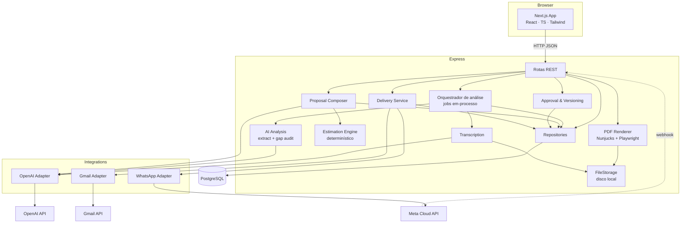

# Arquitetura — Proposal AI

Versão 0.1 · 2026-10-17

Relacionados: [API_SPEC.md](API_SPEC.md) · [AI_PIPELINE.md](AI_PIPELINE.md) · [INTEGRATIONS.md](INTEGRATIONS.md) · [DECISIONS.md](DECISIONS.md)

---

## 1. Visão arquitetural

Monolito modular: um frontend Next.js e um backend Express (Node/TypeScript), com PostgreSQL e armazenamento de arquivos em disco. O pipeline de IA é uma sequência de serviços TypeScript dentro do backend. Integrações externas (OpenAI, Gmail, WhatsApp) ficam atrás de adapters com interface própria, isolados da lógica de negócio.



Princípios:
1. **Rotas finas, serviços gordos.** Rotas validam entrada (Zod), chamam um serviço, mapeiam erro para o formato padrão.
2. **Estado explícito.** Toda entidade com ciclo de vida tem `status` enumerado e transições validadas no serviço, nunca na rota.
3. **Snapshots imutáveis** para versões de proposta; aprovação e envio apontam para IDs de snapshot.
4. **Adapters sem regra de negócio.** `GmailAdapter.send(...)` não sabe o que é proposta; recebe destinatário, assunto, corpo, anexo e devolve `ProviderResult`.
5. **Sem simulação silenciosa.** Ausência de credencial é um estado de domínio (`skipped_no_credentials`), não um `return True`.

## 2. Componentes e responsabilidades

### 2.1 Frontend (`frontend/`)

| Módulo | Responsabilidade |
|--------|------------------|
| `app/` | Rotas Next.js (App Router): dashboard, projeto, reunião, análise, proposta, envio. |
| `features/projects` | Lista e formulário de projeto. |
| `features/meetings` | Upload de áudio / colar transcrição; polling de status; exibição da transcrição. |
| `features/analysis` | Tela de revisão: listas por categoria, ações por item, conclusão da revisão. |
| `features/proposals` | Editor por seção, lista de versões, visualizador de PDF, aprovação. |
| `features/deliveries` | Destinatários, canais, autorização, status por canal, histórico. |
| `services/api.ts` | Cliente HTTP tipado (fetch), tratamento do erro padrão, header `X-Demo-User`. |
| `types/` | Tipos TS espelhando os schemas do backend (gerados do OpenAPI ou mantidos à mão a partir de `docs/examples/`). |
| `lib/` | Formatação, polling hook, store leve de usuário demo. |

### 2.2 Backend (`backend/src/`)

| Camada | Pasta | Responsabilidade |
|--------|-------|------------------|
| API | `routes/` | `projects.ts`, `meetings.ts`, `analysis.ts`, `proposals.ts`, `approvals.ts`, `deliveries.ts`, `authGoogle.ts`, `webhooks.ts`, `health.ts`. |
| API | `middleware/` | Sessão de banco (Prisma), `getDemoUser()` (lê `X-Demo-User`), `requestId`. |
| Core | `core/` | `config.ts` (env validada com Zod), `logging.ts`, `errors.ts` (exceções de domínio → HTTP), `storage.ts` (`FileStorage`). |
| Domínio | `domain/` | Enums de status, transições permitidas, regras puras (ex.: `can_generate_proposal(analysis)`). |
| Schemas | `schemas/` | Zod de entrada/saída da API e dos documentos de IA (`analysis.ts`, `proposal.ts`, `delivery.ts`, `errors.ts`). |
| Modelos | `prisma/schema.prisma` | Prisma ORM (modelos + migrations em `prisma/migrations/`). |
| Repositórios | `repositories/` | CRUD por agregado; única camada que fala com a sessão. |
| Serviços | `services/transcription/` | `TranscriptionService`: valida arquivo, chama adapter OpenAI, normaliza para `Transcript`. |
| Serviços | `services/ai_analysis/` | `extract.ts`, `gap_audit.ts`, `prompts/`, `orchestrator.ts` (sequência + estados). |
| Serviços | `services/estimation/` | `rules.ts` (tabela S/M/L/XL × perfil), `engine.ts`, `historical.ts` (carrega `sample_data/historical_projects.json`). |
| Serviços | `services/proposal/` | `composer.ts` (IA texto), `builder.ts` (monta `ProposalContent`), `versioning.ts`. |
| Serviços | `services/pdf/` | `renderer.ts` (Nunjucks → HTML → Playwright → PDF). |
| Serviços | `services/delivery/` | `service.ts` (autorização, idempotência, fan-out por canal), `channels.ts` (estados). |
| Integrações | `integrations/openai/` | `client.ts` (transcribe, structured completion com retry). |
| Integrações | `integrations/gmail/` | `oauth.ts`, `adapter.ts`. |
| Integrações | `integrations/whatsapp/` | `adapter.ts`, `webhook.ts`. |
| Templates | `templates/proposal/` | `proposal.njk`, `styles.css`, assets. |

## 3. Modelo de dados


Restrições relevantes:
- `PROPOSAL_VERSION(proposal_id, number)` único.
- `DELIVERY(idempotency_key)` único.
- `DELIVERY_CHANNEL(proposal_version_id via delivery→approval, channel, recipient_hash)` único — impede duplicar envio da mesma versão para o mesmo destinatário no mesmo canal (retry manual cria `CHANNEL_EVENT`, não novo canal).
- `content` de análise e proposta é `JSON` (não `JSONB`) por portabilidade SQLite/Postgres (DECISIONS R02).

## 4. Máquinas de estado

### Meeting
```
created ──(áudio)──▶ transcribing ──▶ analyzing ──▶ analysis_ready ──▶ reviewed
   │                      │                │
   └──(texto)─────────────┘                └──▶ failed ──(reprocessar)──▶ analyzing
```

### ProposalVersion
```
draft ──(approve)──▶ approved ──(nova versão aprovada)──▶ superseded
  │
  └──(editar)──▶ cria nova versão draft; a atual permanece draft (imutável)
```
Uma `Proposal` tem no máximo uma versão `approved` por vez.

### Delivery / DeliveryChannel
```
Delivery:  authorized ──▶ in_progress ──▶ completed | partially_failed | failed
Channel:   queued ──▶ sending ──▶ sent ──(webhook WA)──▶ delivered | read
                        │  └──▶ failed ──(retry manual P1)──▶ sending
                        └──▶ skipped_no_credentials
```
Estado agregado do `Delivery` é derivado dos canais: todos `sent/delivered` → `completed`; algum `failed` e algum ok → `partially_failed`; todos `failed` → `failed`. `skipped_no_credentials` conta como "não enviado, sem erro" e aparece explicitamente na UI.

## 5. Fluxo de dados — reunião → análise

```mermaid
sequenceDiagram
    participant U as Usuário
    participant FE as Frontend
    participant API as Express
    participant BG as Job em-processo
    participant OAI as OpenAI
    participant DB as Postgres

    U->>FE: upload áudio / cola transcrição
    FE->>API: POST /projects/{id}/meetings (multipart ou JSON)
    API->>DB: Meeting(status=transcribing|analyzing)
    API-->>FE: 202 { meeting_id, status }
    API->>BG: run_pipeline(meeting_id)
    loop polling 2–3 s
        FE->>API: GET /meetings/{id}
        API-->>FE: { status, progress_step }
    end
    alt áudio
        BG->>OAI: transcribe(file)
        OAI-->>BG: text + segments?
        BG->>DB: Transcript; status=analyzing
    end
    BG->>OAI: extract (structured output)
    OAI-->>BG: MeetingAnalysis (parcial)
    BG->>BG: validar com Zod; verificar quotes existem na transcrição
    BG->>OAI: gap_audit (structured output)
    OAI-->>BG: open_issues + contradições
    BG->>DB: Analysis(content); status=analysis_ready
    FE->>API: GET /meetings/{id}/analysis
    API-->>FE: MeetingAnalysis
```

## 6. Fluxo de dados — proposta → aprovação → envio

```mermaid
sequenceDiagram
    participant U as Usuário
    participant FE as Frontend
    participant API as Express
    participant EST as Estimation
    participant OAI as OpenAI
    participant PDF as Playwright
    participant GM as Gmail
    participant WA as WhatsApp

    U->>FE: "Gerar proposta"
    FE->>API: POST /projects/{id}/proposals { meeting_id }
    API->>API: exige analysis.review_completed
    API->>EST: estimate(modules, complexity) → horas, equipe, cronograma
    API->>OAI: compose_text(analysis validada, estimativas)
    API->>API: build ProposalContent; version 1 (draft); hash
    API-->>FE: 201 Proposal + version 1
    U->>FE: edita campos
    FE->>API: POST /proposals/{id}/versions { content }
    API-->>FE: version 2 (draft)
    FE->>API: POST /proposals/{id}/versions/2/pdf
    API->>PDF: render(template, content v2)
    API-->>FE: { pdf_url }
    U->>FE: "Aprovar v2" (X-Demo-User: Rafael)
    FE->>API: POST /proposals/{id}/versions/2/approve
    API->>API: hash(content) == stored hash; Approval; v2=approved
    U->>FE: destinatários + canais → "Autorizar envio"
    FE->>API: POST /deliveries { approval_id, recipients, channels, idempotency_key }
    API->>API: idempotência; cria Delivery + canais queued
    API-->>FE: 202 Delivery
    par Gmail
        API->>GM: send(pdf, to) → sent | failed | skipped
    and WhatsApp
        API->>WA: send_document(pdf_url, phone) → sent | failed | skipped
    end
    FE->>API: GET /deliveries/{id} (polling)
    API-->>FE: estado por canal
```

## 7. Pipeline de IA (resumo — detalhe em AI_PIPELINE.md)

| Etapa | Serviço | Entrada | Saída | LLM? |
|-------|---------|---------|-------|------|
| 1 Receber | rota | áudio/texto | `Meeting` | não |
| 2 Transcrever | `TranscriptionService` | áudio | `Transcript{text, segments?, metadata}` | modelo de transcrição |
| 3 Extrair | `extract.ts` | transcrição | `MeetingAnalysis` (sem `open_issues` completos) | sim, structured output |
| 4 Validar | `validators.ts` | análise | análise + `limitations[]` | não |
| 5 Auditar lacunas | `gap_audit.ts` | transcrição + análise | `open_issues[]`, contradições | sim, structured output |
| 6 Revisar | UI + `PUT /analysis` | análise | análise com `review_status` por item | humano |
| 7 Construir proposta | `builder.ts` | análise revisada | `ProposalContent` parcial | não |
| 8 Estimar | `estimation/engine.ts` | módulos + complexidade | horas, equipe, cronograma | não |
| 9 Compor texto | `composer.ts` | 7 + 8 | textos das seções | sim, structured output |
| 10 Gerar PDF | `pdf/renderer.ts` | `ProposalContent` | PDF | não |
| 11 Aprovar / autorizar | serviços | — | `Approval`, `Delivery` | humano |

## 8. Integrações externas

| Integração | Adapter | Protocolo | Credenciais | Estado quando ausente |
|------------|---------|-----------|-------------|-----------------------|
| OpenAI | `integrations/openai/client.ts` | SDK oficial JS | `OPENAI_API_KEY` | Pipeline falha com `AI_PROVIDER_NOT_CONFIGURED` (sem IA não há produto) |
| Gmail | `integrations/gmail/` | Google API client JS (`googleapis`), OAuth 2.0 (authorization code) | `GOOGLE_CLIENT_ID/SECRET`, token em `oauth_credentials` | Canal `skipped_no_credentials` |
| WhatsApp | `integrations/whatsapp/` | HTTPS REST (`fetch`/`undici`) para Graph API | `WHATSAPP_TOKEN`, `WHATSAPP_PHONE_NUMBER_ID` | Canal `skipped_no_credentials` |

Interface comum dos canais:
```ts
interface ChannelAdapter {
  channel: "gmail" | "whatsapp";
  isConfigured(): boolean;
  send(req: ChannelSendRequest): ProviderResult;
  // ProviderResult: { ok: boolean, provider_message_id: string|null, error: ProviderError|null, raw: Record<string, unknown> }
}
```
Detalhes em [INTEGRATIONS.md](INTEGRATIONS.md).

## 9. Persistência

- **PostgreSQL 16** via docker-compose; `DATABASE_URL` configurável. Fallback `file:./dev.db` para quem não tem Docker.
- **Prisma ORM** (tipagem gerada do schema; o trabalho pesado é I/O de rede em background e não precisa de async DB).
- **Prisma Migrate** para migrations desde o primeiro modelo. Comando: `prisma migrate deploy` no startup do container.
- **Arquivos** em `STORAGE_DIR` (`./storage` local, volume no Railway): `audio/{meeting_id}.{ext}`, `pdfs/{proposal_id}/v{n}.pdf`. Metadados no banco. Servidos por endpoint autenticado-demo, nunca por diretório estático público.

## 10. Geração documental

1. `ProposalContent` (JSON validado) → contexto Nunjucks.
2. Template `proposal.njk` + `styles.css` (fontes embutidas, cores da identidade, `@page` com margens e numeração).
3. Playwright Chromium headless → `page.setContent(html)` → `page.pdf({ format: "A4", printBackground: true, displayHeaderFooter: true, footerTemplate: "..." })`.
4. Rodapé: `Proposta {title} · v{n} · gerada em {date} · {revision_label}` + número de página.
5. Blocos condicionais: seção comercial só renderiza se `commercial.status != "not_provided"`; aviso de "valores demonstrativos" se `demo_rates`; sugestões da IA sempre com rótulo e cor distinta.
6. Resultado gravado em `PDF_ARTIFACT`; regenerar a mesma versão sobrescreve o arquivo (conteúdo idêntico por construção, exceto data de geração — por isso a data no rodapé é a de **criação da versão**, não a de renderização).

## 11. Decisões arquiteturais e trade-offs

Resumo; justificativas completas em [DECISIONS.md](DECISIONS.md) §2.

| Decisão | Ganho | Custo aceito |
|---------|-------|--------------|
| Jobs assíncronos em-processo + polling | Zero infra extra | Job perdido em restart; sem escala horizontal |
| Prisma ORM | Tipagem gerada + migrations declarativas | Camada extra de codegen; queries `await` (irrelevante nesse volume) |
| JSON para documentos | Schema evolui sem migration | Sem query por campo interno (não precisamos) |
| Snapshots imutáveis | Auditoria e reprodutibilidade | Mais linhas no banco; UI precisa de "versões" |
| IA não estima números | Auditável, sem alucinação de horas | Estimativa menos "inteligente"; depende de boa classificação de complexidade |
| Modo demo de identidade | Rastreabilidade honesta | Não é segurança; não publicar sem auth |
| Playwright | Fidelidade HTML/CSS total | ~300 MB de Chromium no container |

## 12. Tratamento de falhas

| Falha | Detecção | Comportamento | Visível como |
|-------|----------|---------------|--------------|
| Upload inválido (tipo/tamanho) | validação na rota | `400 UPLOAD_INVALID` | Toast com motivo |
| OpenAI indisponível / timeout | exceção do SDK | retry 2× com backoff (1 s, 3 s); depois `Meeting.failed` com `error` | Banner "Falha na análise — reprocessar" |
| Saída da IA inválida (schema) | `ZodError` | reenvia com erro no prompt (até 2×); depois `failed` | idem |
| Quote não encontrada na transcrição | validador pós-extração | item mantido, `confidence` rebaixada para `low`, `limitations[]` registra | Ícone de alerta no item |
| Playwright falha | exceção | `500 PDF_RENDER_FAILED`; versão permanece válida | Botão "tentar novamente" |
| Aprovação de versão alterada | hash ≠ | `409 PROPOSAL_HASH_MISMATCH` | Mensagem de erro |
| Gmail: sem token | `is_configured()==False` | canal `skipped_no_credentials` | Card do canal cinza com explicação + link do PDF |
| Gmail: API erro 4xx/5xx | resposta | canal `failed` com `error.code/message`; outros canais seguem | Card vermelho; retry manual (P1) |
| WhatsApp: fora da janela 24 h sem template | erro 131047/131026 | canal `failed` com explicação legível | idem + link `wa.me` |
| Replay de autorização | `idempotency_key` existente | `200` com delivery existente; sem novo envio | Mesma tela de status |
| Processo reiniciado durante job | status preso em `transcribing/analyzing` > `JOB_STALE_MINUTES` | job marcado `failed` ao ser consultado; "reprocessar" disponível | Banner |

Todos os erros de API seguem o envelope de API_SPEC §2 e são logados com `request_id`.

## 13. Estratégia de deploy

**Recomendado para a demo: tudo local** via `docker compose up` (Postgres + backend + frontend). Menos variáveis, OAuth redirect em `localhost`.

**Opcional (se sobrar tempo, T08):**
- Frontend → Vercel (`NEXT_PUBLIC_API_URL` apontando para o backend).
- Backend → Railway, imagem base `mcr.microsoft.com/playwright:v1.x-jammy`, volume em `/data` para `STORAGE_DIR`, Postgres gerenciado do Railway.
- Ajustar `GOOGLE_REDIRECT_URI` e `CORS_ORIGINS`.
- Webhook do WhatsApp exige URL pública HTTPS — em local, usar túnel (`ngrok`/`cloudflared`) apenas se P1 webhook entrar.

Variáveis completas em `.env.example` e [INTEGRATIONS.md](INTEGRATIONS.md) §5.
