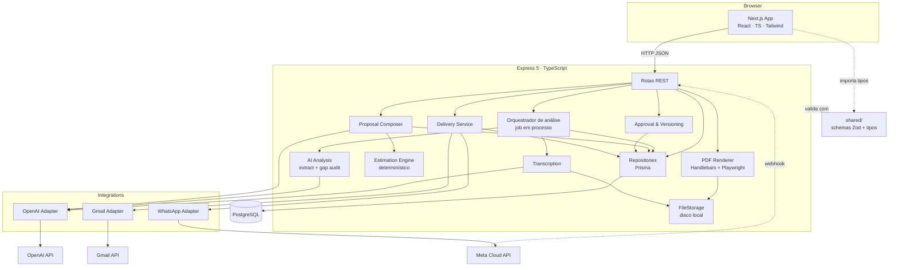
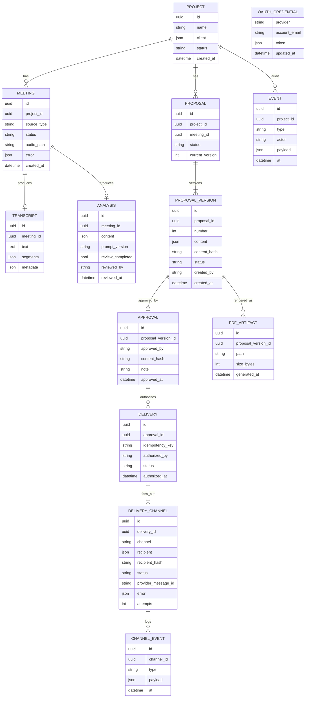

# Arquitetura — Proposal AI

Versão 0.2 · 2026-10-17 · Backend em Node.js/TypeScript (ver DECISIONS D13)

Relacionados: [API_SPEC.md](API_SPEC.md) · [AI_PIPELINE.md](AI_PIPELINE.md) · [INTEGRATIONS.md](INTEGRATIONS.md) · [DECISIONS.md](DECISIONS.md)

---

## 1. Visão arquitetural

Monorepo TypeScript (npm workspaces) com três pacotes: `frontend` (Next.js), `backend` (Express 5) e `shared` (schemas Zod e tipos do contrato). PostgreSQL via Prisma; arquivos em disco. O pipeline de IA é uma sequência de serviços dentro do backend. Integrações externas (OpenAI, Gmail, WhatsApp) ficam atrás de adapters com interface própria, isolados da lógica de negócio.



Princípios:
1. **Rotas finas, serviços gordos.** Rotas validam entrada (Zod), chamam um serviço, e qualquer erro cai no `errorHandler` central que produz o envelope padrão.
2. **Estado explícito.** Toda entidade com ciclo de vida tem `status` enumerado e transições validadas no serviço (`domain/transitions.ts`), nunca na rota.
3. **Snapshots imutáveis** para versões de proposta; aprovação e envio apontam para IDs de snapshot.
4. **Adapters sem regra de negócio.** `gmailAdapter.send(req)` não sabe o que é proposta; recebe destinatário, assunto, corpo, anexo e devolve `ProviderResult`.
5. **Sem simulação silenciosa.** Ausência de credencial é um estado de domínio (`skipped_no_credentials`), não um `return { ok: true }` falso.
6. **Um contrato, um lugar.** Schemas em `shared/`; backend e frontend importam — nunca redefinem.

## 2. Componentes e responsabilidades

### 2.1 `shared/` — contrato

| Arquivo | Conteúdo |
|---------|----------|
| `src/schemas/common.ts` | Enums de status (`MeetingStatus`, `ReviewStatus`, `VersionStatus`, `DeliveryStatus`, `ChannelStatus`, `Channel`) |
| `src/schemas/analysis.ts` | `MeetingAnalysis` e subschemas (AI_PIPELINE §3) |
| `src/schemas/proposal.ts` | `ProposalContent` e subschemas (AI_PIPELINE §8) |
| `src/schemas/delivery.ts` | `Delivery`, `DeliveryChannel`, `CreateDeliveryRequest` |
| `src/schemas/api.ts` | Requests/responses de projetos, reuniões, aprovação; `ApiError` |
| `src/index.ts` | Reexporta schemas e tipos `z.infer` |

### 2.2 Frontend (`frontend/`)

| Módulo | Responsabilidade |
|--------|------------------|
| `src/app/` | Rotas Next.js (App Router): dashboard, projeto, reunião, análise, proposta, envio, configurações. |
| `src/features/projects` | Lista e formulário de projeto. |
| `src/features/meetings` | Upload de áudio / colar transcrição; polling de status; exibição da transcrição. |
| `src/features/analysis` | Tela de revisão: listas por categoria, ações por item, conclusão da revisão. |
| `src/features/proposals` | Editor por seção, lista de versões, visualizador de PDF, aprovação. |
| `src/features/deliveries` | Destinatários, canais, autorização, status por canal, histórico. |
| `src/services/api.ts` | Cliente HTTP tipado (fetch), parse do envelope de erro, header `X-Demo-User`. |
| `src/lib/` | Formatação, hook de polling, store leve do usuário demo, mocks (`NEXT_PUBLIC_USE_MOCKS`). |
| tipos | Importados de `@proposal-ai/shared`. |

### 2.3 Backend (`backend/src/`)

| Camada | Pasta | Responsabilidade |
|--------|-------|------------------|
| Bootstrap | `index.ts`, `app.ts` | Cria o app Express, registra middlewares (`pino-http`, `cors`, `express.json`, `requestId`), rotas e `errorHandler`. |
| Config | `config/env.ts` | `dotenv` + schema Zod das variáveis; falha no boot se faltar obrigatória. |
| API | `api/routes/` | `projects.ts`, `meetings.ts`, `analysis.ts`, `proposals.ts`, `approvals.ts`, `deliveries.ts`, `authGoogle.ts`, `webhooks.ts`, `health.ts`. |
| API | `api/middleware/` | `demoUser.ts` (lê `X-Demo-User`), `validate.ts` (Zod em body/params/query), `errorHandler.ts`, `requestId.ts`, `upload.ts` (`multer`). |
| Core | `core/` | `errors.ts` (`AppError` com `code`/`status`), `logger.ts` (`pino`), `storage.ts` (`FileStorage`), `hash.ts` (SHA-256 canônico). |
| Domínio | `domain/` | Transições permitidas e regras puras (ex.: `canGenerateProposal(analysis)`). |
| Dados | `prisma/schema.prisma`, `src/db.ts` | Schema, migrations, `PrismaClient` singleton. |
| Repositórios | `repositories/` | Acesso por agregado; única camada que fala com o Prisma. |
| Serviços | `services/transcription/` | Valida arquivo, chama adapter OpenAI, normaliza para `Transcript`. |
| Serviços | `services/aiAnalysis/` | `extract.ts`, `gapAudit.ts`, `validators.ts`, `prompts/*.md`, `orchestrator.ts` (sequência + estados). |
| Serviços | `services/estimation/` | `rules.ts` (tabela S/M/L/XL × perfil), `engine.ts`, `historical.ts`. |
| Serviços | `services/proposal/` | `composer.ts` (IA texto), `builder.ts` (monta `ProposalContent`), `versioning.ts`. |
| Serviços | `services/pdf/` | `renderer.ts` (Handlebars → HTML → Playwright → PDF). |
| Serviços | `services/delivery/` | `service.ts` (autorização, idempotência, fan-out por canal), `channels.ts` (estados agregados). |
| Integrações | `integrations/openai/` | `client.ts` (`transcribe`, `structuredCompletion` com retry e log de tokens). |
| Integrações | `integrations/gmail/` | `oauth.ts`, `adapter.ts`, `smtpAdapter.ts` (fallback). |
| Integrações | `integrations/whatsapp/` | `adapter.ts`, `webhook.ts`. |
| Templates | `templates/proposal/` | `proposal.hbs`, `styles.css`, partials; `templates/email/proposal.txt.hbs`. |
| Testes | `tests/` | `vitest` + `supertest`; fixtures gravadas em `tests/fixtures/`. |

## 3. Modelo de dados (Prisma)



Restrições relevantes (`@@unique` no Prisma):
- `ProposalVersion(proposal_id, number)`.
- `Delivery(idempotency_key)`.
- `DeliveryChannel(delivery_id, channel, recipient_hash)` + verificação no serviço de que não existe canal `sent` para a mesma `(proposal_version_id, channel, recipient_hash)` em outro delivery — impede duplicar envio da mesma versão ao mesmo destinatário. Retry manual cria `ChannelEvent`, não novo canal.
- Documentos (`content` de análise e proposta) em coluna `Json`; o schema é garantido pelo Zod na borda, não pelo banco.

## 4. Máquinas de estado

### Meeting
```
created ──(áudio)──▶ transcribing ──▶ analyzing ──▶ analysis_ready ──▶ reviewed
   │                      │                │
   └──(texto)─────────────┘                └──▶ failed ──(reprocessar)──▶ analyzing
```

### ProposalVersion
```
draft ──(approve)──▶ approved ──(nova versão aprovada)──▶ superseded
  │
  └──(editar)──▶ cria nova versão draft; a atual permanece draft (imutável)
```
Uma `Proposal` tem no máximo uma versão `approved` por vez.

### Delivery / DeliveryChannel
```
Delivery:  authorized ──▶ in_progress ──▶ completed | partially_failed | failed
Channel:   queued ──▶ sending ──▶ sent ──(webhook WA)──▶ delivered | read
                        │  └──▶ failed ──(retry manual P1)──▶ sending
                        └──▶ skipped_no_credentials
```
Estado agregado do `Delivery` é derivado dos canais: todos `sent/delivered` → `completed`; algum `failed` e algum ok → `partially_failed`; todos `failed` → `failed`. `skipped_no_credentials` conta como "não enviado, sem erro" e aparece explicitamente na UI.

## 5. Fluxo de dados — reunião → análise

```mermaid
sequenceDiagram
    participant U as Usuário
    participant FE as Frontend
    participant API as Express
    participant JOB as Job em processo
    participant OAI as OpenAI
    participant DB as Postgres

    U->>FE: upload áudio / cola transcrição
    FE->>API: POST /projects/{id}/meetings (multipart ou JSON)
    API->>DB: Meeting(status=transcribing|analyzing)
    API-->>FE: 202 { meeting_id, status }
    API->>JOB: void runPipeline(meetingId)
    loop polling 2–3 s
        FE->>API: GET /meetings/{id}
        API-->>FE: { status, progress }
    end
    alt áudio
        JOB->>OAI: audio.transcriptions.create(stream)
        OAI-->>JOB: text + segments?
        JOB->>DB: Transcript; status=analyzing
    end
    JOB->>OAI: responses.parse(extract, zodTextFormat)
    OAI-->>JOB: ExtractionOutput
    JOB->>JOB: validators (quotes existem, ids, rebaixamentos)
    JOB->>OAI: responses.parse(gap_audit, zodTextFormat)
    OAI-->>JOB: GapAuditOutput
    JOB->>OAI: responses.parse(summarize, zodTextFormat)
    OAI-->>JOB: MeetingSummaryOutput
    JOB->>JOB: validateSummary (ids, quotes, números); falha não bloqueia
    JOB->>DB: Analysis(content + meeting_summary); status=analysis_ready
    FE->>API: GET /meetings/{id}/analysis
    API-->>FE: MeetingAnalysis
```

O resumo (`meeting_summary`) é gravado **dentro do mesmo documento `content` da análise** — não há tabela nova. A etapa de resumo é não bloqueante: se falhar, a reunião segue para `analysis_ready` com `meeting_summary = null` e o resumo pode ser gerado depois por `POST /meetings/{id}/summary`. O progresso expõe `progress.step ∈ {transcribing, extracting, auditing, summarizing}` dentro de `status = analyzing`.

`runPipeline` é chamado sem `await` dentro de um `try/catch` que grava `failed` + `error` em qualquer exceção. Um job preso (processo reiniciado) é detectado no `GET /meetings/{id}`: se `status ∈ {transcribing, analyzing}` e `updated_at` mais antigo que `JOB_STALE_MINUTES`, marca `failed` com `JOB_STALE`.

## 6. Fluxo de dados — proposta → aprovação → envio

```mermaid
sequenceDiagram
    participant U as Usuário
    participant FE as Frontend
    participant API as Express
    participant EST as Estimation
    participant OAI as OpenAI
    participant PDF as Playwright
    participant GM as Gmail
    participant WA as WhatsApp

    U->>FE: "Gerar proposta"
    FE->>API: POST /projects/{id}/proposals { meeting_id }
    API->>API: exige analysis.review_completed
    API->>EST: estimate(modules, openIssues) → horas, equipe, cronograma
    API->>OAI: compose_text(análise filtrada, estimativas)
    API->>API: build ProposalContent; versão 1 (draft); hash
    API-->>FE: 201 Proposal + versão 1
    U->>FE: edita campos
    FE->>API: POST /proposals/{id}/versions { content }
    API-->>FE: versão 2 (draft)
    FE->>API: POST /proposals/{id}/versions/2/pdf
    API->>PDF: render(template, content v2)
    API-->>FE: { url }
    U->>FE: "Aprovar v2" (X-Demo-User: Rafael)
    FE->>API: POST /proposals/{id}/versions/2/approve { content_hash }
    API->>API: hash confere; Approval; v2=approved
    U->>FE: destinatários + canais → "Autorizar envio"
    FE->>API: POST /deliveries { approval_id, channels, idempotency_key }
    API->>API: idempotência; Delivery + canais queued
    API-->>FE: 202 Delivery
    par Gmail
        API->>GM: send(pdf, to) → sent | failed | skipped
    and WhatsApp
        API->>WA: uploadMedia + sendDocument → sent | failed | skipped
    end
    FE->>API: GET /deliveries/{id} (polling)
    API-->>FE: estado por canal
```

## 7. Pipeline de IA (resumo — detalhe em AI_PIPELINE.md)

| Etapa | Módulo | Entrada | Saída | LLM? |
|-------|--------|---------|-------|------|
| 1 Receber | rota | áudio/texto | `Meeting` | não |
| 2 Transcrever | `services/transcription` | áudio | `Transcript{text, segments?, metadata}` | modelo de transcrição |
| 3 Extrair | `aiAnalysis/extract.ts` | transcrição | `ExtractionOutput` | sim, structured output |
| 4 Validar | `aiAnalysis/validators.ts` | extração | extração + `limitations[]` | não |
| 5 Auditar lacunas | `aiAnalysis/gapAudit.ts` | transcrição + extração | `GapAuditOutput` | sim, structured output |
| 5b Resumir | `aiAnalysis/summarize.ts` | transcrição + análise validada | `MeetingSummaryOutput` → `meeting_summary` | sim, structured output (não bloqueante) |
| 6 Revisar | UI + `PUT /analysis` | análise | análise com `review_status` por item | humano |
| 7 Construir proposta | `proposal/builder.ts` | análise revisada | `ProposalContent` parcial | não |
| 8 Estimar | `estimation/engine.ts` | módulos + pendências | horas, equipe, cronograma | não |
| 9 Compor texto | `proposal/composer.ts` | 7 + 8 | textos das seções | sim, structured output |
| 10 Gerar PDF | `pdf/renderer.ts` | `ProposalContent` | PDF | não |
| 11 Aprovar / autorizar | serviços | — | `Approval`, `Delivery` | humano |

## 8. Integrações externas

| Integração | Adapter | Biblioteca | Credenciais | Estado quando ausente |
|------------|---------|-----------|-------------|-----------------------|
| OpenAI | `integrations/openai/client.ts` | `openai` (SDK oficial Node) + `openai/helpers/zod` | `OPENAI_API_KEY` | Pipeline falha com `AI_PROVIDER_NOT_CONFIGURED` |
| Gmail | `integrations/gmail/` | `googleapis` (OAuth2 + `gmail.users.messages.send`), `nodemailer/lib/mail-composer` para o MIME | `GOOGLE_CLIENT_ID/SECRET`, token em `OAuthCredential` | Canal `skipped_no_credentials` |
| WhatsApp | `integrations/whatsapp/` | `fetch` nativo contra Graph API | `WHATSAPP_TOKEN`, `WHATSAPP_PHONE_NUMBER_ID` | Canal `skipped_no_credentials` |

Interface comum dos canais (`services/delivery/types.ts`):
```ts
export interface ChannelAdapter {
  readonly channel: "gmail" | "whatsapp";
  isConfigured(): Promise<boolean>;
  send(req: ChannelSendRequest): Promise<ProviderResult>;
}
export interface ProviderResult {
  ok: boolean;
  providerMessageId: string | null;
  error: { code: string; message: string; retryable: boolean; raw?: unknown } | null;
  raw?: unknown;
}
```
Detalhes em [INTEGRATIONS.md](INTEGRATIONS.md).

## 9. Persistência

- **PostgreSQL 16** via docker-compose; `DATABASE_URL` configurável. Sem Docker, usar um Postgres hospedado gratuito (DECISIONS R02).
- **Prisma**: `schema.prisma` com os modelos da §3; `npx prisma migrate dev` em desenvolvimento, `npx prisma migrate deploy` no startup do container. Client singleton em `src/db.ts`.
- **Arquivos** em `STORAGE_DIR` (`./storage` local, volume no Railway): `audio/{meeting_id}.{ext}`, `pdfs/{proposal_id}/v{n}.pdf`. Metadados no banco. Servidos por rota do backend (`res.sendFile`), nunca por `express.static` público.

## 10. Geração documental

1. `ProposalContent` (validado pelo Zod) → contexto do template.
2. `proposal.hbs` + partials + `styles.css` (fontes embutidas, cores da identidade, `@page` com margens). Handlebars escapa HTML por padrão; helpers registrados em `pdf/helpers.ts` (formatação de números, datas, moeda).
3. Playwright: `chromium.launch()` reutilizado (singleton por processo) → `page.setContent(html, { waitUntil: "networkidle" })` → `page.pdf({ format: "A4", printBackground: true, displayHeaderFooter: true, footerTemplate })`.
4. Rodapé: `Proposta {title} · v{n} · {created_at da versão} · {revision_label}` + número de página.
5. Blocos condicionais: seção comercial só renderiza se `commercial.status != "not_provided"`; aviso de "valores demonstrativos" se `demo_rates`; sugestões da IA sempre com rótulo e cor distinta.
6. Resultado gravado em `PdfArtifact`; regenerar a mesma versão sobrescreve o arquivo (conteúdo idêntico por construção — a data no rodapé é a de **criação da versão**, não a de renderização).

## 11. Decisões arquiteturais e trade-offs

Resumo; justificativas completas em [DECISIONS.md](DECISIONS.md) §2.

| Decisão | Ganho | Custo aceito |
|---------|-------|--------------|
| Node/TS ponta a ponta (D13) | Um idioma; tipos compartilhados; scaffold aproveitado | Diverge do briefing §7 (documentado) |
| Job em processo + polling | Zero infra extra | Job perdido em restart; sem escala horizontal |
| Prisma + Postgres só | Migrations e client tipado prontos | Precisa de Docker ou Postgres hospedado para rodar |
| JSON para documentos | Schema evolui sem migration | Sem query por campo interno (não precisamos) |
| Snapshots imutáveis | Auditoria e reprodutibilidade | Mais linhas no banco; UI precisa de "versões" |
| IA não estima números | Auditável, sem alucinação de horas | Depende de boa classificação de complexidade |
| Modo demo de identidade | Rastreabilidade honesta | Não é segurança; não publicar sem auth |
| Playwright | Fidelidade HTML/CSS total | ~300 MB de Chromium no container |
| `shared/` via workspaces | Contrato único | Setup de workspaces na hora 0 (T09) |

## 12. Tratamento de falhas

| Falha | Detecção | Comportamento | Visível como |
|-------|----------|---------------|--------------|
| Upload inválido (tipo/tamanho) | `multer` `fileFilter`/`limits` | `400 UPLOAD_INVALID` | Toast com motivo |
| OpenAI indisponível / timeout | exceção do SDK (`APIError`, `APIConnectionError`) | retry 3× com backoff (1 s, 3 s, 8 s); depois `Meeting.failed` com `error` | Banner "Falha na análise — reprocessar" |
| Saída da IA inválida (schema) | `ZodError` em `safeParse` | reenvia com erro no prompt (até 2×); depois `failed` | idem |
| Quote não encontrada na transcrição | validador pós-extração | item mantido, `confidence` rebaixada para `low`, `limitations[]` registra | Ícone de alerta no item |
| Playwright falha | exceção | `500 PDF_RENDER_FAILED`; versão permanece válida | Botão "tentar novamente" |
| Aprovação de versão alterada | hash ≠ | `409 PROPOSAL_HASH_MISMATCH` | Mensagem de erro |
| Gmail: sem token | `isConfigured()` false | canal `skipped_no_credentials` | Card cinza com explicação + link do PDF |
| Gmail: API erro 4xx/5xx | resposta | canal `failed` com `error.code/message`; outros canais seguem | Card vermelho; retry manual (P1) |
| WhatsApp: fora da janela 24 h sem template | erro 131047/131026 | canal `failed` com explicação legível | idem + link `wa.me` |
| Replay de autorização | `idempotency_key` existente | `200` com delivery existente; sem novo envio | Mesma tela de status |
| Processo reiniciado durante job | status preso > `JOB_STALE_MINUTES` | marcado `failed` ao ser consultado; "reprocessar" disponível | Banner |
| Rejeição de promise não tratada | `process.on("unhandledRejection")` | log + mantém processo; job correspondente já gravou `failed` no `catch` | — |

Todos os erros de API seguem o envelope de API_SPEC §2 e são logados com `request_id` pelo `pino-http`.

## 13. Estratégia de deploy

**Recomendado para a demo: tudo local** via `docker compose up` (Postgres + backend + frontend). Menos variáveis, OAuth redirect em `localhost`.

**Opcional (se sobrar tempo, T08):**
- Frontend → Vercel (`NEXT_PUBLIC_API_URL` apontando para o backend).
- Backend → Railway, imagem base `mcr.microsoft.com/playwright:v1.x-noble` (inclui Node e Chromium), `npm ci && npm run build && npx prisma migrate deploy && node dist/index.js`, volume em `/data` para `STORAGE_DIR`, Postgres gerenciado do Railway.
- Ajustar `GOOGLE_REDIRECT_URI` e `CORS_ORIGINS`.
- Webhook do WhatsApp exige URL pública HTTPS — em local, usar túnel (`ngrok`/`cloudflared`) apenas se P1 webhook entrar.

Variáveis completas em `.env.example` e [INTEGRATIONS.md](INTEGRATIONS.md) §4.
