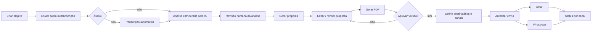

# Especificação de Produto — Proposal AI

Versão 0.1 · 2026-10-17 · Status: rascunho para o hackathon

Documentos relacionados: [ARCHITECTURE.md](ARCHITECTURE.md) · [API_SPEC.md](API_SPEC.md) · [AI_PIPELINE.md](AI_PIPELINE.md) · [UX_FLOW.md](UX_FLOW.md) · [DECISIONS.md](DECISIONS.md)

---

## 1. Visão do produto

**Proposal AI** transforma a gravação (ou transcrição) de uma reunião comercial em uma proposta técnica e comercial estruturada, revisada por humanos e pronta para envio — mantendo rastreabilidade entre cada afirmação da proposta e o trecho da reunião que a originou.

Não é um resumidor de reuniões nem um chatbot. É um fluxo de trabalho com etapas explícitas: **reunião → análise → revisão humana → proposta → PDF → aprovação → autorização de envio → envio por canal → acompanhamento**.

## 2. Problema e público-alvo

### Público inicial
Software houses e consultorias de desenvolvimento (5–100 pessoas) que fazem de 2 a 20 propostas por mês. Dentro delas: o profissional de pré-venda / tech lead que hoje escreve a proposta, e o sócio / gerente comercial que a aprova e envia.

### Problema
Após a reunião, alguém precisa reouvir a gravação ou ler anotações e:
- separar o que o cliente **precisa** do que **pediu**;
- distinguir o que foi **decidido** do que foi apenas **sugerido**;
- registrar **compromissos** (de ambos os lados) sem perder prazos citados;
- listar o que **ficou vago** e pode mudar o preço;
- propor módulos, arquitetura, horas, equipe, cronograma;
- montar o documento e enviá-lo.

Isso leva horas, depende de pessoas específicas e gera erros caros: sugestões viram promessas, requisitos vagos viram escopo fechado, e nada liga a proposta ao que foi dito.

## 3. Proposta de valor

| Para quem | Valor |
|-----------|-------|
| Pré-venda / tech lead | Primeira versão estruturada da análise e da proposta em minutos, com cada item ligado à transcrição; esforço humano vai para revisar, não para digitar. |
| Gestor comercial | Aprovação explícita de uma versão específica; histórico de quem aprovou e enviou o quê, para quem, quando, por qual canal e com que resultado. |
| Cliente final | Proposta consistente, que reflete o que foi conversado e deixa claro o que ainda precisa ser definido. |

Princípio inegociável: **a IA propõe, o humano decide.** Nada é enviado sem aprovação explícita.

## 4. Personas

### P1 — Marina, Tech Lead de pré-venda (usuária principal)
Participa das reuniões, escreve as propostas. Quer gastar tempo validando, não transcrevendo. Precisa confiar que a IA não inventou requisito nem transformou "podemos pensar nisso" em escopo.

### P2 — Rafael, sócio comercial (aprovador)
Não participou de todas as reuniões. Revisa a proposta final, os valores e os destinatários. Precisa ver claramente o que mudou e o que está pendente antes de aprovar. Autoriza o envio.

### P3 — Cliente (destinatário, não usa a plataforma)
Recebe o PDF por e-mail e/ou WhatsApp. Precisa que a proposta reflita a conversa e sinalize pontos em aberto.

## 5. Casos de uso

| ID | Caso de uso | Ator | Prio |
|----|-------------|------|------|
| UC01 | Criar projeto com dados do cliente | P1 | P0 |
| UC02 | Registrar reunião enviando transcrição textual | P1 | P0 |
| UC03 | Registrar reunião enviando áudio para transcrição automática | P1 | P0 |
| UC04 | Acompanhar processamento (transcrevendo → analisando → pronto) | P1 | P0 |
| UC05 | Revisar análise: confirmar, editar, rejeitar ou marcar item como "precisa esclarecimento" | P1 | P0 |
| UC06 | Gerar proposta a partir da análise revisada | P1 | P0 |
| UC07 | Editar campos da proposta (gera nova versão) | P1 | P0 |
| UC08 | Gerar e visualizar PDF de uma versão | P1, P2 | P0 |
| UC09 | Aprovar explicitamente uma versão | P2 | P0 |
| UC10 | Definir destinatários e canais, autorizar envio | P2 | P0 |
| UC11 | Acompanhar estado de cada canal (enviado, falhou, pulado) | P1, P2 | P0 |
| UC12 | Ver histórico de versões e eventos do projeto | P1, P2 | P1 |
| UC13 | Reenviar manualmente um canal que falhou | P2 | P1 |
| UC14 | Consultar propostas anteriores e módulos similares | P1 | P1 |
| UC15 | Ver justificativa de cada estimativa | P1, P2 | P1 |
| UC16 | Receber atualização de entrega do WhatsApp via webhook | sistema | P1 |

## 6. Jornada do usuário (fluxo principal)

Detalhe tela a tela em [UX_FLOW.md](UX_FLOW.md).

## 7. Escopo

### P0 — Essencial (sem isso não há demo)
- Criar/listar/abrir projeto (cliente, contato, nome do projeto).
- Reunião por transcrição textual (colar texto ou `.txt`).
- Reunião por áudio (`.mp3`, `.m4a`, `.wav`, `.webm`; ≤ 25 MB) com transcrição automática.
- Extração estruturada: necessidades, requisitos, módulos, decisões, compromissos, pendências, sugestões técnicas — com referências à transcrição quando disponíveis.
- Tela de revisão da análise com ações por item: confirmar, editar, rejeitar, marcar "precisa esclarecimento".
- Geração da proposta (texto via IA + estimativas/cronograma por motor de regras).
- Edição de campos da proposta → nova versão.
- Geração e visualização do PDF por versão.
- Aprovação explícita de uma versão (quem, quando, hash do conteúdo).
- Tela de destinatários + canais + autorização de envio (quem, quando).
- Envio por Gmail (se credenciais OAuth configuradas).
- Adapter WhatsApp Cloud API completo; envio real se credenciais e janela/template permitirem; senão estado `skipped_no_credentials` visível com alternativa de compartilhamento.
- Estado individual por canal; falha em um não altera o outro; sem duplicidade.
- Dados de demonstração em `sample_data/`.

### P1 — Se houver tempo
- Histórico de versões e eventos (timeline) na tela do projeto.
- Reenvio manual de canal que falhou.
- Justificativa textual de cada linha de estimativa.
- Consulta a propostas anteriores e recuperação de módulos históricos similares.
- Webhook de status do WhatsApp (`delivered`, `read`, `failed`).
- Chunking de áudio > 25 MB.

### P2 — Fora do escopo
- CRM, múltiplos provedores de e-mail/mensageria, autenticação completa multiusuário, fine-tuning, aprendizado com dados de produção, arquitetura distribuída, negociação autônoma de preço, envio sem aprovação humana.

## 8. Requisitos funcionais

| ID | Requisito | Prio |
|----|-----------|------|
| RF01 | Criar um projeto com nome, cliente (empresa), contato (nome, e-mail, telefone opcional) e descrição. | P0 |
| RF02 | Aceitar uma reunião via transcrição textual ou arquivo de áudio, validando tipo e tamanho. | P0 |
| RF03 | Para áudio, transcrever usando o serviço configurado e armazenar a transcrição com metadados (idioma, duração, presença de falantes/timestamps). | P0 |
| RF04 | Produzir uma análise estruturada conforme o schema `MeetingAnalysis` (AI_PIPELINE §3), com cada item carregando `confidence` e `source_refs`. | P0 |
| RF05 | Compromissos registram quem assumiu, lado (cliente/fornecedor), o que, prazo citado, trecho de origem e status (`confirmed`/`tentative`/`conditional`). | P0 |
| RF06 | Não classificar como decisão confirmada ou compromisso confirmado itens sem evidência textual; na dúvida, `pending_validation`/`tentative` com `confidence: low`. | P0 |
| RF07 | Sugestões técnicas da IA ficam em categoria própria e são exibidas com rótulo "Sugestão da IA" na UI e no PDF. | P0 |
| RF08 | A análise lista pendências (informação ausente, requisito vago, contradição, pergunta para próxima reunião) com impacto estimado (esforço/arquitetura/custo/prazo). | P0 |
| RF09 | O usuário pode confirmar, editar, rejeitar ou marcar cada item da análise como "precisa esclarecimento", e marcar a revisão como concluída. | P0 |
| RF10 | A proposta só pode ser gerada a partir de uma análise com revisão concluída; itens rejeitados são excluídos; itens "precisa esclarecimento" vão para "Riscos e pontos pendentes". | P0 |
| RF11 | A proposta segue a estrutura de 16 seções (briefing §5), serializada como `ProposalContent` (AI_PIPELINE §8). | P0 |
| RF12 | Estimativas de horas vêm de um motor de regras determinístico, com premissas listadas e faixa (mín–máx); nunca de texto livre da IA. | P0 |
| RF13 | Valores monetários só aparecem se houver tabela de rates configurada; caso contrário a seção comercial indica "a definir". Rates de demo são rotulados como tal no PDF. | P0 |
| RF14 | Toda edição da proposta cria uma nova versão numerada; versões são imutáveis após criadas. | P0 |
| RF15 | O PDF é gerado a partir do snapshot de uma versão e contém número da versão, data de geração e rótulo de revisão no rodapé. | P0 |
| RF16 | A aprovação registra usuário, data/hora, versão e hash SHA-256 do conteúdo; versões anteriormente aprovadas ficam `superseded`. | P0 |
| RF17 | A autorização de envio registra usuário, data/hora, `approval_id`, destinatários e canais, e exige `idempotency_key`. | P0 |
| RF18 | Cada canal tem estado próprio: `queued`, `sending`, `sent`, `delivered`, `failed`, `skipped_no_credentials`. Falha em um canal não altera o outro. | P0 |
| RF19 | Sem reenvio automático; tentativas repetidas com a mesma chave retornam o delivery existente. | P0 |
| RF20 | Para Gmail, o estado máximo é `sent` (aceito pela API). Para WhatsApp, `delivered` só via webhook. | P0 |
| RF21 | Quando credenciais de um canal não existem, o canal termina em `skipped_no_credentials` com mensagem explicativa e alternativa (link de download do PDF; link `wa.me`). | P0 |
| RF22 | O usuário pode ver o histórico de versões, aprovações e envios do projeto. | P1 |
| RF23 | O usuário pode reenviar manualmente um canal em `failed`, gerando nova tentativa registrada. | P1 |

## 9. Requisitos não funcionais

| ID | Requisito |
|----|-----------|
| RNF01 | **Segurança de segredos:** chaves OpenAI, Google e Meta somente no backend, via variáveis de ambiente. Nenhum segredo no bundle do frontend. |
| RNF02 | **Identidade (limitação):** sem autenticação real no MVP. Operações de revisão, aprovação e autorização exigem header `X-Demo-User` para rastreabilidade. Documentado como modo demonstração. |
| RNF03 | **Validação de upload:** tipos permitidos e tamanho máximo configuráveis (`MAX_UPLOAD_MB`, padrão 25). |
| RNF04 | **Latência:** processamento de reunião assíncrono; UI mostra progresso; nenhuma requisição HTTP bloqueia > 30 s. |
| RNF05 | **Resiliência da IA:** saídas inválidas são rejeitadas pela validação Zod e reprocessadas até 2 vezes com feedback do erro; falha definitiva deixa a reunião em `failed` com motivo. |
| RNF06 | **Reprodutibilidade:** o PDF de uma versão pode ser regenerado a qualquer momento a partir do snapshot, com conteúdo idêntico. |
| RNF07 | **Auditoria:** eventos de domínio (criação, análise pronta, revisão concluída, versão criada, aprovação, autorização, resultado por canal) gravados em `events` com ator e timestamp. |
| RNF08 | **Idempotência:** chave única por delivery; unicidade `(proposal_version_id, channel, recipient)`. |
| RNF09 | **Portabilidade:** `docker compose up` sobe tudo; `.env.example` completo; funciona sem credenciais de Gmail/WhatsApp (canais pulados explicitamente). |
| RNF10 | **Observabilidade mínima:** logs estruturados com `request_id`; tempo e tokens de cada chamada de IA registrados. |
| RNF11 | **Privacidade:** arquivos de áudio e PDFs servidos apenas pelo backend; `sample_data/` não contém dados reais. |

## 10. Critérios de aceitação (por etapa do fluxo)

| Etapa | Aceito quando |
|-------|---------------|
| Projeto | Criar projeto e vê-lo na lista com status "Sem reunião". |
| Reunião (texto) | Colar transcrição de `sample_data/sample_transcript_pt.txt` → status `analyzing` → `analysis_ready` em < 90 s. |
| Reunião (áudio) | Upload de `sample_data/sample_meeting.mp3` → `transcribing` → `analyzing` → `analysis_ready`; transcrição visível. |
| Análise | Para a transcrição de exemplo: ≥ 3 requisitos, ≥ 1 decisão confirmada, ≥ 1 decisão pendente, ≥ 1 compromisso com dono, ≥ 2 pendências e ≥ 1 sugestão rotulada como da IA. Nenhuma sugestão aparece como decisão. Cada item tem ao menos um `source_ref.quote` que existe literalmente na transcrição. |
| Revisão | Rejeitar um item e editar outro; marcar revisão concluída; recarregar a página e ver as alterações persistidas. |
| Proposta | Gerar proposta; 16 seções presentes; item rejeitado ausente; item "precisa esclarecimento" listado em pendências; estimativas com faixa e premissas. |
| PDF | Abrir PDF da v1; rodapé com "v1 · data · rascunho". Editar um campo → v2 → PDF v2 difere apenas no campo e no rodapé. |
| Aprovação | Aprovar v2 informando `X-Demo-User`; tela mostra "Aprovada por X em Y"; a UI bloqueia edição da v2 e oferece "criar nova versão a partir desta" (v3); não existe endpoint de alteração de versão — qualquer tentativa pela API retorna `409 PROPOSAL_VERSION_IMMUTABLE`. |
| Envio | Autorizar envio para e-mail + telefone. Gmail com credenciais → `sent` com `provider_message_id`. WhatsApp sem credenciais → `skipped_no_credentials` com link alternativo. Gmail `sent` permanece após WhatsApp pular/falhar. |
| Duplicidade | Repetir a autorização com a mesma `idempotency_key` → `200` com o mesmo delivery, sem novo envio. |
| Falha | Com `GMAIL_FORCE_FAIL=true` (flag de demo) → Gmail `failed` com erro legível; proposta continua `approved`; WhatsApp não afetado. |

## 11. Métricas de sucesso do MVP (mensuráveis no cenário de demo)

| Métrica | Como medir | Alvo demo |
|---------|------------|-----------|
| Tempo reunião → análise pronta | `analysis_ready_at − created_at` | < 2 min para 8 min de áudio |
| Tempo análise revisada → PDF v1 | timestamps | < 60 s |
| Precisão de classificação (amostra) | Comparar com gabarito manual `sample_data/sample_analysis_expected.json` | ≥ 80% dos itens do gabarito presentes; 0 sugestões classificadas como decisão |
| Fidelidade das referências | % de `source_ref.quote` que ocorrem literalmente (normalizando espaços) na transcrição | ≥ 90% |
| Integridade do fluxo | Checklist de critérios §10 | 100% dos P0 |
| Segurança do envio | Nenhum envio sem `approval_id`; replay com mesma chave não duplica | 100% |

Não prometemos redução de tempo em relação ao processo manual: isso só pode ser medido com usuários reais após o hackathon.

## 12. Limitações conhecidas

1. **Sem autenticação real.** `X-Demo-User` é rastreabilidade, não segurança. Não expor publicamente sem auth.
2. **Diarização de falantes** depende do serviço de transcrição; quando ausente, "quem prometeu" é inferido pelo texto e marcado com confiança baixa.
3. **Estimativas são demonstrativas**, baseadas em regras e histórico fictício. Não refletem produtividade real de nenhuma equipe.
4. **Gmail:** `sent` significa "aceito pela API do Gmail", não "entregue na caixa do cliente".
5. **WhatsApp:** envio real exige app Meta, número verificado e, fora da janela de 24 h, template aprovado — pode não estar disponível na demo.
6. **Jobs em background** vivem no processo da API; reinício perde jobs em andamento (estado `failed` + reprocessar manualmente).
7. **Áudio > 25 MB / 60 min** não é aceito no MVP.
8. **Uma transcrição = uma análise**; reprocessar substitui a análise (a anterior fica em `events`, não é restaurável pela UI).
9. **Tokens OAuth** armazenados no banco sem criptografia adicional no MVP — adequado para demo local, não para produção.
