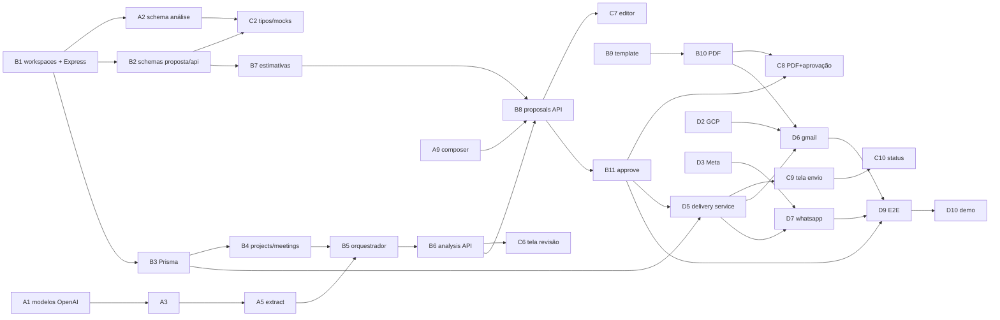

# Plano de Trabalho da Equipe — 24 horas

Versão 0.2 · 2026-10-17 · Stack Node/TypeScript (ver DECISIONS D13)

Relacionados: [DECISIONS.md](DECISIONS.md) (pendências T01–T09, abertas A01–A08) · [API_SPEC.md](API_SPEC.md) · [AI_PIPELINE.md](AI_PIPELINE.md) · [INTEGRATIONS.md](INTEGRATIONS.md) · [UX_FLOW.md](UX_FLOW.md)

> **Divisão adotada pelo time:** [roadmap/](roadmap/README.md) — P1 backend (inclui integrações), P2 frontend A (entrada e revisão), P3 frontend B (proposta, aprovação e envio), P4 IA. Este documento mantém a referência detalhada de tarefas na divisão A/B/C/D original; os IDs de tarefa (A1…, B1…, C1…, D1…) são citados pelos roadmaps individuais. Em caso de conflito de atribuição, vale o roadmap.

---

## 1. Regras do jogo

1. **Contratos primeiro.** Até H+2 ninguém implementa tela ou serviço sem o schema Zod correspondente existir em `shared/src/schemas/` e validar os JSONs de `docs/examples/`. O frontend desenvolve contra os JSONs de exemplo (mock) até o endpoint real existir.
2. **Trunk-based.** Branch `main` sempre sobe com `docker compose up`. Commits pequenos; PR opcional; sem rebase longo. Quebrou o `main`, para e conserta.
3. **Caminho feliz antes de robustez.** Primeiro a jornada ponta a ponta com transcrição textual (H+10); depois áudio, PDF bonito, Gmail, falhas.
4. **Checkpoints a cada 4 h** (15 min, em pé): o que fechou, o que bloqueia, o que corta.
5. **Congelamento H+22.** Depois disso só bug crítico e ensaio.

## 2. Divisão de responsabilidades (4 pessoas)

| Pessoa | Papel | Pastas principais | Entrega-chave |
|--------|-------|-------------------|---------------|
| **A** | AI Engineering | `backend/src/services/{transcription,aiAnalysis,estimation/rules.ts}`, `backend/src/integrations/openai`, `shared/src/schemas/analysis.ts`, `sample_data/`, `backend/tests/ai` | Análise estruturada confiável a partir de texto e áudio |
| **B** | Backend & documentos | `backend/src/{app,index}.ts`, `api/`, `prisma/`, `repositories/`, `services/{proposal,pdf,estimation/engine.ts}`, `shared/src/schemas/{proposal,api,common}.ts`, `templates/`, Dockerfile, workspaces | API completa, versionamento, aprovação, PDF |
| **C** | Frontend | `frontend/` | Todas as telas T1–T9 com estados |
| **D** | Integrações & produto | `backend/src/integrations/{gmail,whatsapp}`, `services/delivery`, `shared/src/schemas/delivery.ts`, `.env.example`, `docker-compose.yml`, identidade visual, roteiro de demo, testes E2E | Envio por canal com estados honestos; demo ensaiada |

## 3. Tarefas por pessoa

Legenda: **[P0]** essencial · **[P1]** se der tempo · ✅ critério de pronto.

### Pessoa A — AI Engineering

| # | Tarefa | Prio | Janela | Depende | Pronto quando |
|---|--------|------|--------|---------|---------------|
| A1 | Validar acesso OpenAI (`scripts/check-openai.ts`, `npm run check:openai`): modelos de chat com structured outputs e transcrição; fixar `OPENAI_MODEL`/`OPENAI_TRANSCRIBE_MODEL` (T01) | P0 | H0–1 | — | ✅ script imprime modelos OK; `.env` do time atualizado |
| A2 | Implementar `shared/src/schemas/analysis.ts` exatamente como AI_PIPELINE §3 (variantes `ExtractionOutput`/`GapAuditOutput` estritas + `MeetingAnalysis`); testar `zodTextFormat` aceita o schema (H11) | P0 | H0–2 | T09 | ✅ `MeetingAnalysis.parse(analysis.example.json)` passa; C e B desbloqueados |
| A3 | `integrations/openai/client.ts`: `transcribe(path)`, `structuredCompletion(...)` com retry/backoff e log de tokens/latência em `logs/ai_runs.jsonl` | P0 | H1–3 | A1 | ✅ teste com mock do SDK |
| A4 | Escrever `sample_data/sample_transcript_pt.txt` (com D) e `sample_analysis_expected.json` | P0 | H1–4 | — | ✅ contém os itens plantados (AI_PIPELINE §11) |
| A5 | `prompts/extract.md` v1 + `prompts/loader.ts` (`gray-matter`) + `extract.ts` | P0 | H2–6 | A2, A3 | ✅ transcrição de exemplo → `ExtractionOutput` válido; ≥ 80% do gabarito |
| A6 | `validators.ts` (quotes, ids, rebaixamentos) | P0 | H5–7 | A5 | ✅ testes unitários das 6 regras |
| A7 | `prompts/gap_audit.md` + `gapAudit.ts` + fusão no `orchestrator.ts` (com B5) | P0 | H6–9 | A5 | ✅ contradição plantada detectada; compromisso condicional não sai `confirmed` |
| A8 | `services/transcription/service.ts` (validação, chamada, normalização de segmentos) | P0 | H8–11 | A3 | ✅ `sample_meeting.mp3` → transcrição com metadata correta |
| A9 | `prompts/compose_proposal.md` + `composer.ts` (com B) | P0 | H10–14 | B8 | ✅ `ProposalTextOutput` válido; builder mantém números das estimativas |
| A10 | Calibrar `estimation/rules.ts` com `historical_projects.json` (T07, com B) | P0 | H12–14 | B7 | ✅ faixa plausível para a reunião de exemplo |
| A11 | `repair.md` + loop de retry por validação | P0 | H14–16 | A6 | ✅ fixture inválida aciona 2ª tentativa |
| A12 | Suíte `tests/ai` (8 testes de AI_PIPELINE §11) com fixtures gravadas + `npm run test:ai` | P1 | H16–19 | tudo | ✅ `npm test` e `npm run test:ai` verdes |
| A13 | Justificativa textual por linha de estimativa (`rationale`) | P1 | H19–21 | A10 | ✅ aparece no PDF |

### Pessoa B — Backend & documentos

| # | Tarefa | Prio | Janela | Depende | Pronto quando |
|---|--------|------|--------|---------|---------------|
| B1 | **Workspaces (T09)**: `package.json` raiz com `workspaces: ["backend","frontend","shared"]`, `shared/package.json` (`@proposal-ai/shared`), lockfile único; `next.config.ts` com `transpilePackages`. Evoluir scaffold Express: `app.ts`, `config/env.ts` (dotenv + Zod), `pino-http` + `requestId`, `cors`, `errorHandler` (envelope API_SPEC §2), `/health` | P0 | H0–2 | — | ✅ `npm install` na raiz; `npm run dev -w backend` sobe; `GET /health` responde; erro padrão testado com supertest |
| B2 | `shared/src/schemas/{common,proposal,api}.ts` (API_SPEC §3, AI_PIPELINE §8) + validar `docs/examples/*.json` | P0 | H0–2 | B1 | ✅ exemplos passam no `parse`; C desbloqueado |
| B3 | `prisma/schema.prisma` (ARCHITECTURE §3) + `prisma migrate dev`; `docker-compose.yml` com Postgres (com D); `src/db.ts` | P0 | H1–4 | B1 | ✅ `npx prisma migrate dev` cria todas as tabelas |
| B4 | Repositórios + rotas **Projects** e **Meetings** (`POST` texto JSON / áudio `multer` com `fileFilter`+`limits`, `GET`, `reprocess`) + `core/storage.ts` | P0 | H3–6 | B1, B3 | ✅ criar projeto e reunião por texto via supertest |
| B5 | `orchestrator.ts` (job em processo com `try/catch` → `failed`) + estados de `Meeting` + `JOB_STALE_MINUTES`; integrar extração da A | P0 | H5–8 | B4, A5 | ✅ texto → `analysis_ready` ponta a ponta |
| B6 | Rotas **Analysis** (`GET`, `PUT` com preservação de `meta`, `complete-review`) + middleware `demoUser` | P0 | H7–9 | B5 | ✅ critérios "Revisão" de PRODUCT_SPEC §10 |
| B7 | `services/estimation/engine.ts` (AI_PIPELINE §9) + `historical.ts` | P0 | H8–11 | B2 | ✅ determinístico; teste unitário |
| B8 | `services/proposal/builder.ts` + `versioning.ts` (hash com `fast-json-stable-stringify`, imutabilidade) + rotas **Proposals** (`POST`, `GET`, `versions`) | P0 | H9–13 | B6, B7, A9 | ✅ gerar proposta e criar v2 via API |
| B9 | Template `templates/proposal/proposal.hbs` + partials + `styles.css` (16 seções, blocos condicionais, rótulo de sugestão, rodapé com versão) + `pdf/helpers.ts` | P0 | H11–15 | B2 | ✅ HTML abre no navegador com dados do exemplo |
| B10 | `services/pdf/renderer.ts` (Playwright Node, browser singleton) + rotas `POST/GET …/pdf`; Dockerfile sobre `mcr.microsoft.com/playwright` (T04) | P0 | H13–16 | B9 | ✅ PDF A4 gerado em < 10 s local e no container |
| B11 | Rota **Approve** (hash check, supersede, `Approval`) + eventos de auditoria (`Event`) | P0 | H15–17 | B8 | ✅ critérios "Aprovação" de PRODUCT_SPEC §10 |
| B12 | Rota `GET /projects/{id}/events` (timeline) | P1 | H18–20 | B11 | ✅ eventos listados |
| B13 | Hardening: limites de upload, mensagens de erro, `JOB_STALE`, seeds de demo (`scripts/seed-demo.ts`) | P0 | H18–22 | tudo | ✅ seed cria projeto pronto para cada etapa da demo |

### Pessoa C — Frontend

| # | Tarefa | Prio | Janela | Depende | Pronto quando |
|---|--------|------|--------|---------|---------------|
| C1 | Layout base sobre o scaffold Next.js 16, `DemoUserBadge`, `services/api.ts` (envelope de erro, header `X-Demo-User`, interceptor 401) | P0 | H0–2 | — | ✅ app sobe; erro padrão exibido em toast |
| C2 | Importar tipos de `@proposal-ai/shared` (fallback: copiar schemas para `src/types/`) + mocks em `lib/mocks/` (`NEXT_PUBLIC_USE_MOCKS`) carregando `docs/examples/*.json` | P0 | H1–3 | A2, B2 | ✅ telas rodam sem backend |
| C3 | T1 Dashboard + T2 Novo projeto + T9 Configurações (usuário demo) | P0 | H2–5 | C1 | ✅ criar projeto contra API real (B4) ou mock |
| C4 | T3 Projeto: `FlowStepper`, cards por etapa com bloqueios | P0 | H4–7 | C3 | ✅ stepper reflete `status` |
| C5 | T4 Nova reunião: abas texto/áudio, dropzone, `ProcessingPanel` com polling, erro + reprocessar | P0 | H5–8 | C4, B4 | ✅ critérios "Reunião (texto)" |
| C6 | T5 Revisão: `AnalysisSections`, `ReviewableItemCard` (4 ações + edição inline), `TranscriptPane` com destaque de quote, barra de progresso, salvar/concluir | P0 | H7–13 | C2, B6 | ✅ critérios "Análise" e "Revisão" |
| C7 | T6 Proposta — aba Editar: navegação por 16 seções, `EditableList`, módulos, estimativas somente leitura, salvar como nova versão, bloqueio de versão aprovada; validação do formulário com o próprio schema Zod | P0 | H12–16 | B8 | ✅ criar v2 pela UI |
| C8 | T6 — abas PDF (`PdfViewer`, gerar/baixar) e Versões; `ApprovalModal` com hash | P0 | H15–18 | B10, B11 | ✅ critérios "PDF" e "Aprovação" |
| C9 | T7 Envio: `ApprovedVersionSummary`, `RecipientForm`, `ChannelSelector` com status de `/health`, modal de autorização, `idempotency_key` em `sessionStorage` | P0 | H17–20 | D5 | ✅ autorizar envio pela UI |
| C10 | T8 Status: `ChannelStatusCard` com todos os estados, alternativas (`wa.me`, `mailto`, download), polling | P0 | H19–21 | D5 | ✅ critérios "Envio" e "Falha" |
| C11 | Polimento: responsivo, skeletons, guard de alterações não salvas, textos finais com D | P0 | H21–22 | tudo | ✅ demo roda sem layout quebrado em 1366×768 |
| C12 | `EventTimeline` em T3; botão retry em T8 | P1 | H22–23 | B12, D7 | — |

### Pessoa D — Integrações & produto

| # | Tarefa | Prio | Janela | Depende | Pronto quando |
|---|--------|------|--------|---------|---------------|
| D1 | `.env.example` completo (INTEGRATIONS §4), `README.md` seções de setup, `docker-compose.yml` com B | P0 | H0–2 | — | ✅ pessoa nova sobe o projeto seguindo o README |
| D2 | Google Cloud: projeto, Gmail API, consent Testing + test users, client OAuth (T02) | P0 | H0–3 | — | ✅ `client_id/secret` no `.env` compartilhado |
| D3 | Meta: app, número de teste, token, destinatários de teste; **decisão go/no-go WhatsApp real até H+6** (T03) | P0 | H1–6 | — | ✅ `curl` de teste envia texto ao celular do demonstrador, **ou** fallback R13 registrado em DECISIONS |
| D4 | Com A: roteiro da reunião fictícia; gravar `sample_meeting.mp3` (5–8 min); `vendor_profile.json`, `historical_projects.json` (T05) | P0 | H2–6 | — | ✅ arquivos em `sample_data/` com rótulo de demonstração |
| D5 | `shared/src/schemas/delivery.ts` + `services/delivery/{service,channels,types}.ts` (idempotência, validação de destinatário, fan-out, estados agregados, `alternative`) + rotas **Deliveries**; adapters iniciam como "não configurado" | P0 | H4–10 | B1, B3 | ✅ `POST /deliveries` sem credenciais → ambos `skipped_no_credentials`; replay → mesmo delivery |
| D6 | `integrations/gmail/oauth.ts` (`googleapis` OAuth2) + rotas `/auth/google/*` + `adapter.ts` (`MailComposer` + anexo + `messages.send`) + `GMAIL_FORCE_FAIL` | P0 | H8–14 | D2, D5, B10 | ✅ PDF real chega na caixa de teste; `FORCE_FAIL` → `failed` isolado |
| D7 | `integrations/whatsapp/adapter.ts` (upload de mídia + mensagem de documento via `fetch`), mapeamento de erros, `WHATSAPP_FORCE_FAIL` | P0 | H12–16 | D3, D5 | ✅ envio real **ou** erro mapeado legível (`131047`, `131030`) |
| D8 | Identidade visual: paleta, logo fictício, CSS do PDF com B, textos de e-mail/legenda (T06) | P0 | H10–16 | B9 | ✅ PDF e UI com a mesma identidade |
| D9 | Testes E2E (`scripts/e2e-demo.ts` chamando a API na ordem da demo) | P0 | H16–20 | B11, D6 | ✅ script percorre criar → … → delivery e valida estados |
| D10 | Roteiro da demo (README §"Fluxo de demonstração"), seeds com B, ensaio cronometrado | P0 | H20–23 | tudo | ✅ demo de 6–8 min ensaiada 2× |
| D11 | Webhook WhatsApp + túnel; retry manual de canal | P1 | H20–22 | D7 | — |

## 4. Dependências críticas (grafo)

**Caminho crítico:** B1 → A2/A3 → A5 → B5 → B6 → B8 → B11 → D5/D6 → D9 → D10. B1 (workspaces) é a primeira hora de todos — se atrasar, aplicar o fallback de R18 (copiar schemas) e seguir.

## 5. Marcos

| Hora | Marco | Verificação |
|------|-------|-------------|
| **H+2** | Contratos congelados | `shared/src/schemas/*.ts` validam `docs/examples/*.json`; Express sobe com `/health` e envelope de erro; frontend sobe com mocks; `.env.example` pronto |
| **H+6** | Primeira análise real | Transcrição de exemplo → `MeetingAnalysis` válido pela API; go/no-go WhatsApp |
| **H+10** | **Jornada vertical v0** (texto) | UI: criar projeto → colar transcrição → ver análise → revisar → concluir. Sem proposta ainda. |
| **H+14** | Proposta gerada | API gera `ProposalContent` com estimativas; HTML do template renderiza; áudio transcreve |
| **H+18** | **Jornada completa v1** | UI: … → gerar proposta → editar v2 → PDF → aprovar → autorizar envio (canais pulados ok) |
| **H+20** | Envio real | Gmail entrega PDF; WhatsApp real ou fallback honesto; `FORCE_FAIL` demonstra falha isolada; E2E verde |
| **H+22** | **Congelamento** | Só bugs críticos; seeds; ensaio 1 |
| **H+23** | Ensaio 2 cronometrado | Roteiro final; backup de PDF e prints caso a rede falhe |
| **H+24** | Demo | — |

## 6. Variante com 3 pessoas

Remover a Pessoa D e redistribuir:

| Tarefas de D | Vai para | Ajuste |
|--------------|----------|--------|
| D1 (.env, README, compose), D5 (delivery service), D6 (Gmail) | **B** | B entrega PDF mais simples (template básico em H+13, polimento em H+19) |
| D2, D3 (credenciais Google/Meta) | **A** nas primeiras 3 h (enquanto espera validação de modelos) | A começa A5 em H+3 em vez de H+2 |
| D7 (WhatsApp) | **B**, apenas adapter + `skipped_no_credentials` + erros mapeados | Envio real WhatsApp vira P1 |
| D4 (sample data), D8 (identidade), D10 (roteiro) | **C** | C usa componentes padrão Tailwind sem customização; T9 mínima |
| D9 (E2E) | **A** | script em TS em H+17–19 |
| D11 | cortado | — |

Marcos deslocam ~2 h (jornada completa em H+20, congelamento H+22 mantido cortando C11/C12).

## 7. Plano de contingência

| Se até… | …isto não aconteceu | Então |
|---------|---------------------|-------|
| H+2 | Workspaces/`shared` com atrito no Next | Fallback R18: copiar `shared/src/schemas/*.ts` para `frontend/src/types/`; B2 mantém sincronia |
| H+3 | Modelos OpenAI com structured outputs não disponíveis | `response_format: json_object` + validação Zod + repair (já previsto); A perde ~1 h |
| H+3 | `zodTextFormat` rejeita o schema (H11) | Simplificar aninhamento ou `zod-to-json-schema` manual |
| H+6 | Extração não atinge 80% do gabarito | Aceitar 60%; priorizar que **nada falso-positivo** vire `confirmed`; ajustar prompt em paralelo até H+12 |
| H+6 | WhatsApp real inviável | Go/no-go: fallback R13 (`skipped_no_credentials` + `wa.me`). Não gastar mais tempo. |
| H+8 | Transcrição de áudio instável | Demo usa transcrição textual; áudio mostrado só se funcionar no ensaio. Upload continua implementado. |
| H+12 | Gmail OAuth não conecta | `smtpAdapter.ts` com `nodemailer` + app password (mesma interface), UI rotula "SMTP" |
| H+14 | Playwright falha no container | Rodar backend fora do Docker na demo; ou Puppeteer + `@sparticuz/chromium` |
| H+16 | Editor da proposta (C7) atrasado | Editor reduzido: só sumário executivo, escopo, premissas e próximos passos editáveis; demais somente leitura |
| H+18 | Jornada completa não fecha na UI | Demo híbrida: UI até a revisão; proposta/aprovação/envio via `curl`/`scripts/e2e-demo.ts` com narrativa honesta. Cortar C11/C12, B12, A12, A13, D11. |
| H+20 | Estimativas implausíveis | Ajustar `rules.ts` (é dado); explicar na demo que é base demonstrativa |
| H+22 | Qualquer coisa | **Congelar.** Gravar vídeo de backup da jornada funcionando; preparar PDF gerado e prints. |

## 8. Definição de pronto (DoD) por etapa

| Etapa | Pronto quando |
|-------|---------------|
| Contrato | Schema Zod em `shared/` + exemplo JSON em `docs/examples/` validado por teste + referência no API_SPEC |
| Endpoint | Validação Zod na entrada; retorna envelope de erro padrão; coberto por teste `supertest` ou pelo E2E |
| Serviço de IA | Teste com fixture gravada (sem rede) + 1 execução real registrada em `logs/ai_runs.jsonl` |
| Tela | Estados: carregando, vazio, erro, sucesso; funciona com mock e com API; sem erro no console |
| Integração | `isConfigured()` correto; envio real **ou** estado `skipped`/`failed` legível; nunca sucesso simulado |
| Demo | Roteiro escrito; 2 ensaios; backup gravado |

## 9. Comunicação

- Canal único (Slack/Discord) com threads: `#contratos`, `#bloqueios`, `#demo`.
- Mudança em contrato → mensagem em `#contratos` + commit no `docs/` e em `shared/` **antes** do código que o consome.
- Bloqueio > 30 min → avisar em `#bloqueios`; quem está livre ajuda.
- Checkpoints: H+2, H+6, H+10, H+14, H+18, H+22.
