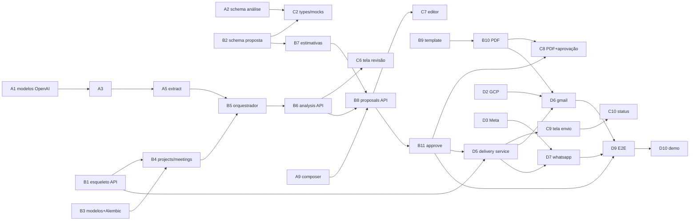

# Plano de Trabalho da Equipe — 24 horas

Versão 0.1 · 2026-10-17

Relacionados: [DECISIONS.md](DECISIONS.md) (pendências T01–T08, abertas A01–A08) · [API_SPEC.md](API_SPEC.md) · [AI_PIPELINE.md](AI_PIPELINE.md) · [INTEGRATIONS.md](INTEGRATIONS.md) · [UX_FLOW.md](UX_FLOW.md)

---

## 1. Regras do jogo

1. **Contratos primeiro.** Até H+2 ninguém implementa tela ou serviço sem o schema correspondente existir em `backend/app/schemas/` e em `docs/examples/`. O frontend desenvolve contra os JSONs de exemplo (mock) até o endpoint real existir.
2. **Trunk-based.** Branch `main` sempre sobe com `docker compose up`. Commits pequenos; PR opcional; sem rebase longo. Quebrou o `main`, para e conserta.
3. **Caminho feliz antes de robustez.** Primeiro a jornada ponta a ponta com transcrição textual (H+10); depois áudio, PDF bonito, Gmail, falhas.
4. **Checkpoints a cada 4 h** (15 min, em pé): o que fechou, o que bloqueia, o que corta.
5. **Congelamento H+22.** Depois disso só bug crítico e ensaio.

## 2. Divisão de responsabilidades (4 pessoas)

| Pessoa | Papel | Pastas principais | Entrega-chave |
|--------|-------|-------------------|---------------|
| **A** | AI Engineering | `services/transcription`, `services/ai_analysis`, `services/estimation` (regras), `schemas/analysis.py`, `integrations/openai`, `sample_data/`, `tests/ai` | Análise estruturada confiável a partir de texto e áudio |
| **B** | Backend & documentos | `main.py`, `api/`, `models/`, `repositories/`, `services/proposal`, `services/pdf`, `schemas/proposal.py`, `templates/`, Alembic, docker | API completa, versionamento, aprovação, PDF |
| **C** | Frontend | `frontend/` | Todas as telas T1–T9 com estados |
| **D** | Integrações & produto | `integrations/gmail`, `integrations/whatsapp`, `services/delivery`, `schemas/delivery.py`, `.env.example`, identidade visual, roteiro de demo, testes E2E | Envio por canal com estados honestos; demo ensaiada |

## 3. Tarefas por pessoa

Legenda: **[P0]** essencial · **[P1]** se der tempo · ⛓ depende de · ✅ critério de pronto.

### Pessoa A — AI Engineering

| # | Tarefa | Prio | Janela | Depende | Pronto quando |
|---|--------|------|--------|---------|---------------|
| A1 | Validar acesso OpenAI (`scripts/check_openai.py`): modelos de chat com structured outputs e transcrição; fixar `OPENAI_MODEL`/`OPENAI_TRANSCRIBE_MODEL` (T01) | P0 | H0–1 | — | ✅ script imprime modelos OK; `.env` do time atualizado |
| A2 | Implementar `schemas/analysis.py` exatamente como AI_PIPELINE §3 + gerar `docs/examples/analysis.example.json` a partir dele | P0 | H0–2 | — | ✅ `MeetingAnalysis.model_validate(example)` passa; C e B desbloqueados |
| A3 | `integrations/openai/client.py`: `transcribe(path)`, `structured_completion(prompt, schema, …)` com retry/backoff e log de tokens/latência | P0 | H1–3 | A1 | ✅ teste com fixture |
| A4 | Escrever `sample_data/sample_transcript_pt.txt` (com D) e `sample_analysis_expected.json` | P0 | H1–4 | — | ✅ contém os itens plantados (AI_PIPELINE §11) |
| A5 | `prompts/extract.md` v1 + `extract.py` | P0 | H2–6 | A2, A3 | ✅ transcrição de exemplo → `ExtractionOutput` válido; ≥ 80% do gabarito |
| A6 | `validators.py` (quotes, ids, rebaixamentos) | P0 | H5–7 | A5 | ✅ testes unitários das 6 regras |
| A7 | `prompts/gap_audit.md` + `gap_audit.py` + fusão no orquestrador | P0 | H6–9 | A5 | ✅ contradição plantada detectada; compromisso condicional não sai `confirmed` |
| A8 | `services/transcription/service.py` (validação, chamada, normalização de segmentos) | P0 | H8–11 | A3 | ✅ `sample_meeting.mp3` → transcrição com metadata correta |
| A9 | `prompts/compose_proposal.md` + `composer.py` (com B) | P0 | H10–14 | B8 | ✅ `ProposalTextOutput` válido; não altera números das estimativas |
| A10 | Calibrar `estimation/rules.py` com `historical_projects.json` (T07, com B) | P0 | H12–14 | B7 | ✅ faixa plausível para a reunião de exemplo |
| A11 | `repair.md` + loop de retry por validação | P0 | H14–16 | A6 | ✅ fixture inválida aciona 2ª tentativa |
| A12 | Suíte `tests/ai` (8 testes de AI_PIPELINE §11) + `logs/ai_runs.jsonl` | P1 | H16–19 | tudo | ✅ `pytest -m ai` verde |
| A13 | Justificativa textual por linha de estimativa (`rationale`) | P1 | H19–21 | A10 | ✅ aparece no PDF |

### Pessoa B — Backend & documentos

| # | Tarefa | Prio | Janela | Depende | Pronto quando |
|---|--------|------|--------|---------|---------------|
| B1 | Esqueleto FastAPI: `main.py`, `core/config.py`, `core/errors.py` (envelope API_SPEC §2), `core/logging.py` com `request_id`, CORS, `/health` | P0 | H0–2 | — | ✅ `GET /health` responde; erro padrão testado |
| B2 | `schemas/proposal.py` (AI_PIPELINE §8), `schemas/common.py` (enums API_SPEC §3), `schemas/errors.py`; `docs/examples/proposal_content.example.json` | P0 | H0–2 | — | ✅ exemplo valida; C desbloqueado |
| B3 | Modelos SQLAlchemy + Alembic inicial (ARCHITECTURE §3); docker-compose com Postgres; fallback SQLite | P0 | H1–4 | — | ✅ `alembic upgrade head` em Postgres e SQLite |
| B4 | Repositórios + rotas **Projects** e **Meetings** (`POST` texto/áudio multipart com validação, `GET`, `reprocess`) + `FileStorage` | P0 | H3–6 | B1, B3 | ✅ criar projeto e reunião por texto via `/docs` |
| B5 | Orquestrador `BackgroundTasks` + estados de `Meeting` + `JOB_STALE_MINUTES`; integrar extração da A | P0 | H5–8 | B4, A5 | ✅ texto → `analysis_ready` ponta a ponta |
| B6 | Rotas **Analysis** (`GET`, `PUT` com regras de preservação de `meta`, `complete-review`) + `X-Demo-User` dependency | P0 | H7–9 | B5 | ✅ critérios "Revisão" de PRODUCT_SPEC §10 |
| B7 | `services/estimation/engine.py` (AI_PIPELINE §9) + `historical.py` | P0 | H8–11 | B2 | ✅ determinístico; teste unitário |
| B8 | `services/proposal/builder.py` + `versioning.py` (hash, imutabilidade) + rotas **Proposals** (`POST`, `GET`, `versions`) | P0 | H9–13 | B6, B7, A9 | ✅ gerar proposta e criar v2 via API |
| B9 | Template `proposal.html.j2` + `styles.css` (16 seções, blocos condicionais, rótulo de sugestão, rodapé com versão) | P0 | H11–15 | B2 | ✅ HTML abre no navegador com dados do exemplo |
| B10 | `services/pdf/renderer.py` (Playwright) + rotas `POST/GET …/pdf`; Dockerfile com Chromium (T04) | P0 | H13–16 | B9 | ✅ PDF A4 gerado em < 10 s local e no container |
| B11 | Rota **Approve** (hash check, supersede, `Approval`) + eventos de auditoria (`events`) | P0 | H15–17 | B8 | ✅ critérios "Aprovação" de PRODUCT_SPEC §10 |
| B12 | Rota `GET /projects/{id}/events` (timeline) | P1 | H18–20 | B11 | ✅ eventos listados |
| B13 | Hardening: limites de upload, mensagens de erro, `JOB_STALE`, seeds de demo (`scripts/seed_demo.py`) | P0 | H18–22 | tudo | ✅ seed cria projeto pronto para cada etapa da demo |

### Pessoa C — Frontend

| # | Tarefa | Prio | Janela | Depende | Pronto quando |
|---|--------|------|--------|---------|---------------|
| C1 | Bootstrap Next.js (App Router, TS, Tailwind), layout base, `DemoUserBadge`, `services/api.ts` (envelope de erro, header `X-Demo-User`, interceptor 401) | P0 | H0–2 | — | ✅ app sobe; erro padrão exibido em toast |
| C2 | `types/api.ts` a partir de `docs/examples/*.json` + mocks em `lib/mocks/` (fetch condicional `NEXT_PUBLIC_USE_MOCKS`) | P0 | H1–3 | A2, B2 | ✅ telas rodam sem backend |
| C3 | T1 Dashboard + T2 Novo projeto + T9 Configurações (usuário demo) | P0 | H2–5 | C1 | ✅ criar projeto contra API real (B4) ou mock |
| C4 | T3 Projeto: `FlowStepper`, cards por etapa com bloqueios | P0 | H4–7 | C3 | ✅ stepper reflete `status` |
| C5 | T4 Nova reunião: abas texto/áudio, dropzone, `ProcessingPanel` com polling, erro + reprocessar | P0 | H5–8 | C4, B4 | ✅ critérios "Reunião (texto)" |
| C6 | T5 Revisão: `AnalysisSections`, `ReviewableItemCard` (4 ações + edição inline), `TranscriptPane` com destaque de quote, barra de progresso, salvar/concluir | P0 | H7–13 | C2, B6 | ✅ critérios "Análise" e "Revisão" |
| C7 | T6 Proposta — aba Editar: navegação por 16 seções, `EditableList`, módulos, estimativas somente leitura, salvar como nova versão, bloqueio de versão aprovada | P0 | H12–16 | B8 | ✅ criar v2 pela UI |
| C8 | T6 — abas PDF (`PdfViewer`, gerar/baixar) e Versões; `ApprovalModal` com hash | P0 | H15–18 | B10, B11 | ✅ critérios "PDF" e "Aprovação" |
| C9 | T7 Envio: `ApprovedVersionSummary`, `RecipientForm`, `ChannelSelector` com status de `/health`, modal de autorização, `idempotency_key` em `sessionStorage` | P0 | H17–20 | D5 | ✅ autorizar envio pela UI |
| C10 | T8 Status: `ChannelStatusCard` com todos os estados, alternativas (`wa.me`, `mailto`, download), polling | P0 | H19–21 | D5 | ✅ critérios "Envio" e "Falha" |
| C11 | Polimento: responsivo, skeletons, guard de alterações não salvas, textos finais com D | P0 | H21–22 | tudo | ✅ demo roda sem layout quebrado em 1366×768 |
| C12 | `EventTimeline` em T3; botão retry em T8 | P1 | H22–23 | B12, D7 | — |

### Pessoa D — Integrações & produto

| # | Tarefa | Prio | Janela | Depende | Pronto quando |
|---|--------|------|--------|---------|---------------|
| D1 | `.env.example` completo (INTEGRATIONS §4), `README.md` seções de setup, `docker-compose.yml` com B | P0 | H0–2 | — | ✅ pessoa nova sobe o projeto seguindo o README |
| D2 | Google Cloud: projeto, Gmail API, consent Testing + test users, client OAuth (T02) | P0 | H0–3 | — | ✅ `client_id/secret` no `.env` compartilhado |
| D3 | Meta: app, número de teste, token, destinatários de teste; **decisão go/no-go WhatsApp real até H+6** (T03) | P0 | H1–6 | — | ✅ `curl` de teste envia texto ao celular do demonstrador, **ou** fallback R13 registrado em DECISIONS |
| D4 | Com A: roteiro da reunião fictícia; gravar `sample_meeting.mp3` (5–8 min); `vendor_profile.json`, `historical_projects.json` (T05) | P0 | H2–6 | — | ✅ arquivos em `sample_data/` com rótulo de demonstração |
| D5 | `schemas/delivery.py` + `services/delivery/service.py` (idempotência, validação de destinatário, fan-out, estados agregados, `alternative`) + rotas **Deliveries**; adapters iniciam como "não configurado" | P0 | H4–10 | B1, B3 | ✅ `POST /deliveries` sem credenciais → ambos `skipped_no_credentials`; replay → mesmo delivery |
| D6 | `integrations/gmail/oauth.py` + rotas `/auth/google/*` + `adapter.py` (MIME + anexo) + `GMAIL_FORCE_FAIL` | P0 | H8–14 | D2, D5, B10 | ✅ PDF real chega na caixa de teste; `FORCE_FAIL` → `failed` isolado |
| D7 | `integrations/whatsapp/adapter.py` (upload de mídia + mensagem de documento), mapeamento de erros, `WHATSAPP_FORCE_FAIL` | P0 | H12–16 | D3, D5 | ✅ envio real **ou** erro mapeado legível (`131047`, `131030`) |
| D8 | Identidade visual: paleta, logo fictício, CSS do PDF com B, textos de e-mail/legenda (T06) | P0 | H10–16 | B9 | ✅ PDF e UI com a mesma identidade |
| D9 | Testes E2E (script `scripts/e2e_demo.sh`/`.py` chamando a API na ordem da demo) | P0 | H16–20 | B11, D6 | ✅ script percorre criar → … → delivery e valida estados |
| D10 | Roteiro da demo (README §"Fluxo de demonstração"), seeds com B, ensaio cronometrado | P0 | H20–23 | tudo | ✅ demo de 6–8 min ensaiada 2× |
| D11 | Webhook WhatsApp + túnel; retry manual de canal | P1 | H20–22 | D7 | — |

## 4. Dependências críticas (grafo)

**Caminho crítico:** A1 → A3 → A5 → B5 → B6 → B8 → B11 → D5/D6 → D9 → D10. Qualquer atraso na extração (A5) atrasa tudo — por isso C trabalha com mocks e B constrói Projects/Meetings em paralelo.

## 5. Marcos

| Hora | Marco | Verificação |
|------|-------|-------------|
| **H+2** | Contratos congelados | `schemas/*.py` + `docs/examples/*.json` validam; API esqueleto sobe; frontend sobe com mocks; `.env.example` pronto |
| **H+6** | Primeira análise real | Transcrição de exemplo → `MeetingAnalysis` válido pela API (`/docs`); go/no-go WhatsApp |
| **H+10** | **Jornada vertical v0** (texto) | UI: criar projeto → colar transcrição → ver análise → revisar → concluir. Sem proposta ainda. |
| **H+14** | Proposta gerada | API gera `ProposalContent` com estimativas; HTML do template renderiza; áudio transcreve |
| **H+18** | **Jornada completa v1** | UI: … → gerar proposta → editar v2 → PDF → aprovar → autorizar envio (canais pulados ok) |
| **H+20** | Envio real | Gmail entrega PDF; WhatsApp real ou fallback honesto; `FORCE_FAIL` demonstra falha isolada; E2E verde |
| **H+22** | **Congelamento** | Só bugs críticos; seeds; ensaio 1 |
| **H+23** | Ensaio 2 cronometrado | Roteiro final; backup de PDF e prints caso a rede falhe |
| **H+24** | Demo | — |

## 6. Variante com 3 pessoas

Remover a Pessoa D e redistribuir:

| Tarefas de D | Vai para | Ajuste |
|--------------|----------|--------|
| D1 (.env, README, compose), D5 (delivery service), D6 (Gmail) | **B** | B entrega PDF mais simples (template básico em H+13, polimento em H+19) |
| D2, D3 (credenciais Google/Meta) | **A** nas primeiras 3 h (enquanto espera validação de modelos) | A começa A5 em H+3 em vez de H+2 |
| D7 (WhatsApp) | **B**, apenas adapter + `skipped_no_credentials` + erros mapeados | Envio real WhatsApp vira P1 |
| D4 (sample data), D8 (identidade), D10 (roteiro) | **C** | C usa componentes padrão Tailwind sem customização; T9 mínima |
| D9 (E2E) | **A** | script simples em Python em H+17–19 |
| D11 | cortado | — |

Marcos deslocam ~2 h (jornada completa em H+20, congelamento H+22 mantido cortando C11/C12).

## 7. Plano de contingência

| Se até… | …isto não aconteceu | Então |
|---------|---------------------|-------|
| H+3 | Modelos OpenAI com structured outputs não disponíveis | Usar `json_object` + validação Pydantic + repair (já previsto); A perde ~1 h |
| H+6 | Extração não atinge 80% do gabarito | Aceitar 60%; priorizar que **nada falso-positivo** vire `confirmed`; ajustar prompt em paralelo até H+12 |
| H+6 | WhatsApp real inviável | Go/no-go: fallback R13 (`skipped_no_credentials` + `wa.me`). Não gastar mais tempo. |
| H+8 | Transcrição de áudio instável | Demo usa transcrição textual; áudio mostrado só se funcionar no ensaio. Upload continua implementado. |
| H+12 | Gmail OAuth não conecta | `GmailSmtpAdapter` com app password (mesma interface), UI rotula "SMTP" |
| H+14 | Playwright falha no container | Rodar backend fora do Docker na demo; ou WeasyPrint com o mesmo HTML |
| H+16 | Editor da proposta (C7) atrasado | Editor reduzido: só sumário executivo, escopo, premissas e próximos passos editáveis; demais somente leitura |
| H+18 | Jornada completa não fecha na UI | Demo híbrida: UI até a revisão; proposta/aprovação/envio via `/docs` do FastAPI com narrativa honesta. Cortar C11/C12, B12, A12, A13, D11. |
| H+20 | Estimativas implausíveis | Ajustar `rules.py` (é dado); explicar na demo que é base demonstrativa |
| H+22 | Qualquer coisa | **Congelar.** Gravar vídeo de backup da jornada funcionando; preparar PDF gerado e prints. |

## 8. Definição de pronto (DoD) por etapa

| Etapa | Pronto quando |
|-------|---------------|
| Contrato | Pydantic + exemplo JSON em `docs/examples/` + referência no API_SPEC; frontend tem tipo TS |
| Endpoint | Aparece em `/docs`; retorna envelope de erro padrão; coberto pelo E2E ou por teste de rota |
| Serviço de IA | Teste com fixture gravada (sem rede) + 1 execução real registrada em `logs/ai_runs.jsonl` |
| Tela | Estados: carregando, vazio, erro, sucesso; funciona com mock e com API; sem erro no console |
| Integração | `is_configured()` correto; envio real **ou** estado `skipped`/`failed` legível; nunca sucesso simulado |
| Demo | Roteiro escrito; 2 ensaios; backup gravado |

## 9. Comunicação

- Canal único (Slack/Discord) com threads: `#contratos`, `#bloqueios`, `#demo`.
- Mudança em contrato → mensagem em `#contratos` + commit no `docs/` **antes** do código.
- Bloqueio > 30 min → avisar em `#bloqueios`; quem está livre ajuda.
- Checkpoints: H+2, H+6, H+10, H+14, H+18, H+22.
