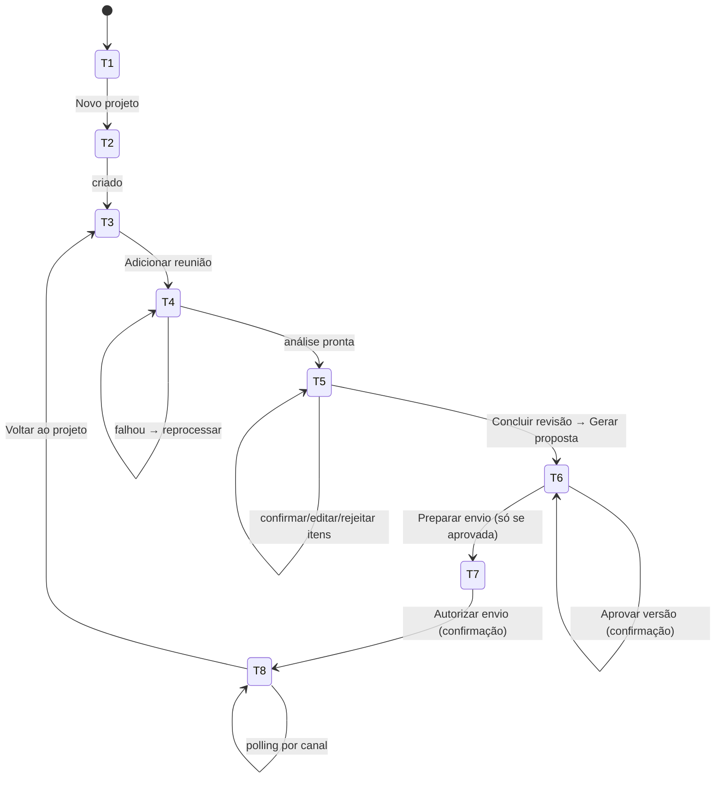

# Fluxo de UX — Proposal AI

Versão 0.1 · 2026-10-17

Relacionados: [PRODUCT_SPEC.md](PRODUCT_SPEC.md) §6 · [API_SPEC.md](API_SPEC.md) §6 (mapa telas × endpoints)

Responsável: Pessoa C (frontend) com Pessoa D (identidade visual, textos).

---

## 1. Princípios de interface

1. **Estados visíveis.** A etapa atual do fluxo é sempre mostrada em um stepper no topo da página do projeto: *Reunião → Análise → Proposta → Aprovação → Envio*.
2. **Gerar ≠ aprovar ≠ enviar ≠ entregar.** Quatro verbos, quatro botões distintos, quatro badges distintos. Nunca um "Enviar" que aprova implicitamente.
3. **Rótulos de origem.** Tudo que a IA sugeriu tem badge **"Sugestão da IA"** (cor própria). Tudo que o humano alterou tem badge **"Editado"**. Tudo confirmado tem **"Confirmado por {nome}"**.
4. **Citações à mão.** Todo item da análise tem um "ver na transcrição" que expande a `quote` (e pula para o segmento, se houver timestamp).
5. **Nada é destrutivo sem confirmação.** Reprocessar análise, rejeitar item, aprovar versão e autorizar envio abrem confirmação com texto explícito do efeito.
6. **Usuário demo visível.** O nome em `X-Demo-User` aparece no canto superior direito com rótulo "Modo demonstração — identidade não autenticada".

## 2. Mapa de telas

| # | Tela | Rota | Objetivo |
|---|------|------|----------|
| T1 | Dashboard | `/` | Listar projetos com status; criar novo; indicador de canais configurados |
| T2 | Novo projeto | `/projects/new` | Formulário cliente + projeto |
| T3 | Projeto | `/projects/[id]` | Stepper + resumo de cada etapa + ações; timeline (P1) |
| T4 | Nova reunião | `/projects/[id]/meetings/new` | Abas "Colar transcrição" / "Enviar áudio"; progresso |
| T5 | Revisão da análise | `/meetings/[id]/analysis` | Revisar por categoria; concluir revisão |
| T6 | Proposta | `/proposals/[id]` | Editor por seção, versões, PDF, aprovação |
| T7 | Envio | `/proposals/[id]/deliveries/new` | Destinatários, canais, autorização |
| T8 | Status de envio | `/deliveries/[id]` | Estado por canal, erros, alternativas, retry (P1) |
| T9 | Configurações | `/settings` | Conectar Gmail, ver status WhatsApp, definir usuário demo |

## 3. Jornada detalhada

## 4. Telas e componentes

### T1 — Dashboard
- `ProjectCard`: nome, cliente, badge de status do projeto (`no_meeting`, `processing`, `analysis_ready`, `reviewed`, `proposal_draft`, `proposal_approved`, `sent`, `failed`), última atualização.
- `ChannelHealthBar` (de `GET /health`): "Gmail: conectado como x@…" / "WhatsApp: não configurado" com link para T9.
- `DemoUserBadge` (canto superior): nome do usuário demo; clique → T9.
- Vazio: ilustração + "Crie seu primeiro projeto".

### T2 — Novo projeto
- Campos: nome do projeto, descrição; empresa do cliente, contato (nome, e-mail, telefone opcional com máscara E.164).
- Validação inline; botão "Criar e adicionar reunião" (vai para T4) e "Criar".

### T3 — Projeto
- `FlowStepper`: 5 etapas; a atual destacada; etapas concluídas com check; etapas bloqueadas com cadeado e tooltip do porquê ("Conclua a revisão da análise para gerar a proposta").
- Cards por etapa:
  - **Reunião:** status, duração, fonte (áudio/texto), **manchete e resumo executivo** (`meeting_summary`; se `null`, mostra `summary` ou "Resumo indisponível" com botão "Gerar resumo"), botão "Ver transcrição" (drawer) / "Reprocessar".
  - **Análise:** contadores por categoria (ex.: 7 requisitos · 2 decisões · 3 compromissos · 4 pendências · 2 sugestões) e % revisado; botão "Revisar".
  - **Proposta:** versão atual, versão aprovada, botão "Abrir".
  - **Envio:** último delivery com mini-badges por canal; botão "Ver".
- `EventTimeline` (P1): lista de eventos com ator e hora.

### T4 — Nova reunião
- Abas: **Colar transcrição** (textarea grande, contador de palavras, campo idioma) · **Enviar áudio** (dropzone; formatos e limite exibidos; nome e tamanho do arquivo).
- Ao enviar → `ProcessingPanel`:
  - Etapas verticais: *Enviando arquivo → Transcrevendo → Analisando → Auditando lacunas → Resumindo a reunião → Pronto*; a atual com spinner; `progress.message` do backend abaixo.
  - Polling 2–3 s em `GET /meetings/{id}`; para ao atingir `analysis_ready`/`failed`.
  - Em `failed`: `ErrorBanner` com `error.message` legível e botão "Reprocessar" (`POST /reprocess`).
  - Ao ficar pronto: CTA "Revisar análise" (T5).
- Se o usuário sair da página, o card da reunião em T3 continua mostrando o progresso.

### T5 — Revisão da análise
No topo, acima das duas colunas, o **`SummaryPanel`** (recolhível; aberto por padrão):
- Manchete (`headline`) e resumo executivo (`executive_summary`).
- **Tópicos** em ordem cronológica: título + resumo curto; cada um mostra `mm:ss` (se há timestamp) e, ao clicar, o `TranscriptPane` rola até o trecho citado.
- Faixa de **chips por id** que resolvem o texto na própria análise: *Decisões confirmadas* · *Decisões pendentes* · *Próximos passos* (com status do compromisso e prazo dito) · *Pontos em aberto* (até 5; o restante fica na análise, com link "ver todas as N pendências"). Clicar num chip rola até o `ReviewableItemCard` correspondente.
- Rodapé: "Resumo gerado por IA às {hora} · base: análise completa | itens revisados". Se `review_completed` e `basis = "analysis"`, badge "Gerado antes da revisão — pode incluir itens rejeitados" + botão **Atualizar resumo** (`POST …/summary` com `basis: "reviewed"`, com confirmação). Botão **Copiar resumo** (texto puro) para colar em e-mail/chat.
- Estado vazio (`meeting_summary = null`): "Não foi possível resumir esta reunião" + botão **Gerar resumo**. A revisão da análise não depende dele.
- Rótulo fixo: "Resumo gerado por IA a partir da transcrição. A fonte de verdade são os itens abaixo."

Layout em duas colunas (desktop) / abas (mobile):
- **Esquerda — `AnalysisSections`** (acordeões com contador e barra de progresso de revisão):
  1. Resumo curto de contexto (`summary` da extração; somente leitura, editável como texto) — o resumo completo está no `SummaryPanel`.
  2. Participantes.
  3. Necessidades do cliente.
  4. Requisitos e módulos (requisitos agrupados por módulo; chip de complexidade S/M/L/XL editável; "sem módulo" ao final).
  5. Decisões — sub-grupos **Confirmadas** / **Pendentes de validação**.
  6. Compromissos — tabela: quem · lado · o quê · prazo dito · status · ressalvas.
  7. Pendências e ambiguidades — tipo, impacto (chips), pergunta sugerida.
  8. Sugestões da IA — fundo e badge distintos, texto fixo "Estas sugestões não foram validadas com o cliente".
  9. Limitações da análise (lista, só leitura).
- **Direita — `TranscriptPane`**: transcrição completa com busca; ao clicar "ver na transcrição" em um item, rola e destaca a `quote`. Se há timestamps, mostra `mm:ss`.
- **`ReviewableItemCard`** (componente central):
  - Cabeçalho: id curto, badge de confiança (alta/média/baixa com ícone), badge de `review_status`.
  - Corpo: campos editáveis inline (clique no lápis → inputs; salvar/cancelar).
  - Ações: **Confirmar** · **Editar** · **Rejeitar** · **Precisa esclarecimento** (abre campo de nota).
  - Rodapé: "ver na transcrição" (1 ou mais quotes); `reviewer_note`.
  - Para decisões: toggle Confirmada ↔ Pendente. Para compromissos: select de status.
- Barra inferior fixa: "X de Y itens revisados" · botão **Salvar rascunho** (`PUT /analysis`) · botão **Concluir revisão** (habilitado quando 100% ou com checkbox "aceitar pendentes como confirmados" — exibe aviso).
- Confirmação ao concluir: "Itens rejeitados não entrarão na proposta. Itens marcados como 'precisa esclarecimento' entrarão como pontos pendentes. Continuar?" → `POST /complete-review` → CTA "Gerar proposta".

### T6 — Proposta
- Cabeçalho: título, `VersionSelector` (v1, v2…, badge por versão: rascunho/aprovada/substituída), `ApprovalBadge` ("Aprovada por Rafael em 17/10 14:32" ou "Não aprovada").
- Abas: **Editar** · **Pré-visualizar PDF** · **Versões**.
- **Editar** — `ProposalEditor`: navegação lateral com as 16 seções; cada seção um `SectionEditor`:
  - Textos longos: textarea com auto-altura.
  - Listas (objetivos, premissas, exclusões, próximos passos, riscos): `EditableList` (adicionar/remover/reordenar).
  - Módulos: cards com nome, descrição, features, complexidade.
  - Arquitetura: textos + preview do Mermaid; badge fixo "Sugestão da IA".
  - **Estimativas, equipe, cronograma: somente leitura** com nota "Calculado pelo motor de estimativas a partir dos módulos e pendências. Para alterar, ajuste a complexidade dos módulos e regenere." + botão "Recalcular" (P1). Faixa mín–máx, premissas listadas.
  - Comercial: se `demo_rates`, banner amarelo "Valores demonstrativos"; se `not_provided`, texto "A definir".
  - Se a versão exibida está `approved`/`superseded`: campos bloqueados, banner "Versão aprovada é imutável. **Criar nova versão a partir desta**".
  - Rodapé fixo: indicador "alterações não salvas" · **Salvar como nova versão** (abre campo `change_note`) → `POST /versions`.
- **Pré-visualizar PDF** — `PdfViewer` (iframe de `GET …/pdf`); botão "Gerar/atualizar PDF" (`POST …/pdf`) com spinner; botão "Baixar". Enquanto não gerado: placeholder "PDF ainda não gerado para esta versão".
- **Versões** — tabela: nº, status, criada por, data, nota, hash curto, ações (abrir, PDF).
- **Aprovar** — botão primário visível só em versão `draft` com PDF gerado; modal: resumo (versão, hash curto, nº de pendências em aberto, se há valores demonstrativos), campo nota, checkbox "Revisei o PDF desta versão", confirmar → `POST /approve` com `content_hash`. Erro `PROPOSAL_HASH_MISMATCH` → "O conteúdo mudou desde que você abriu. Recarregue."
- Após aprovar: CTA **Preparar envio** (T7). Botões de edição somem; aparece "Criar nova versão".

### T7 — Envio
- Bloqueio: se nenhuma versão aprovada → página mostra "Aprove uma versão antes de enviar" com link para T6.
- `ApprovedVersionSummary`: versão, aprovador, data, hash curto, link para PDF.
- `RecipientForm`: pré-preenchido com contato do cliente; e-mail e telefone editáveis; validação por canal.
- `ChannelSelector`: cards **Gmail** e **WhatsApp** com checkbox; cada card mostra estado de configuração (de `/health`): "Conectado como x@…" / "Não configurado — será marcado como pulado; você receberá um link alternativo". Canal não configurado **pode** ser selecionado (para demonstrar o estado), com aviso.
- Campos por canal: Gmail → assunto, corpo (pré-preenchidos); WhatsApp → legenda.
- Botão **Autorizar envio** → modal: "Você está autorizando o envio da **v2 aprovada por Rafael** para **ana@example.com (Gmail)** e **+55 11 99999-0000 (WhatsApp)**. Esta ação será registrada em seu nome ({demo user})." → gera `idempotency_key` (uuid no cliente, guardado em `sessionStorage` por proposta) → `POST /deliveries` → T8.

### T8 — Status de envio
- Cabeçalho: delivery id curto, autorizado por/quando, versão, badge de `DeliveryStatus` agregado.
- `ChannelStatusCard` por canal:
  - Ícone do canal, destinatário, badge de `ChannelStatus` com cores: `queued`/`sending` azul com spinner · `sent` verde "Aceito pelo provedor" · `delivered`/`read` verde escuro · `failed` vermelho · `skipped_no_credentials` cinza.
  - Linha de tempo do canal: tentativas, timestamps, `provider_message_id` (copiável).
  - Em `failed`: `error.message` legível; se `retryable`, botão **Tentar novamente** (P1) com confirmação; senão dica de correção.
  - Em `skipped_no_credentials`: explicação + botões "Abrir no WhatsApp Web" (`wa.me`) / "Abrir e-mail" (`mailto`) + "Baixar PDF".
  - Texto fixo em Gmail `sent`: "Aceito pelo Gmail. Entrega na caixa do destinatário não é confirmada por este sistema." Em WhatsApp `sent` sem webhook: "Aceito pelo WhatsApp; confirmação de entrega indisponível neste ambiente."
- Polling 2–3 s até `status ∉ {in_progress}`; depois para.
- Rodapé: "Voltar ao projeto" · "Novo envio" (volta a T7 com nova `idempotency_key`).

### T9 — Configurações
- `DemoUserForm`: campo nome → salvo em `localStorage`; aviso "Modo demonstração: este nome identifica quem revisa, aprova e autoriza envios. Não é autenticação."
- `GoogleConnectCard`: estado (`configured`/`connected`/`account_email`), botão "Conectar Gmail" (`<a href=/auth/google/start>`), "Desconectar". Trata `?google=connected|error`.
- `WhatsAppStatusCard`: somente leitura — configurado ou não; link para INTEGRATIONS no README.

## 5. Estados globais e feedback

| Situação | Componente | Comportamento |
|----------|------------|---------------|
| Carregando dados | `Skeleton` por card | nunca spinner de página inteira |
| Processo longo | `ProcessingPanel` / `ChannelStatusCard` | etapas nomeadas + mensagem do backend; polling |
| Erro de API | `ErrorBanner`/toast | mostra `error.message`; `request_id` em "detalhes"; botão de ação quando houver (reprocessar, recarregar, reconectar) |
| Falta `X-Demo-User` | interceptor em `services/api.ts` | redireciona para T9 com aviso "Defina seu nome para continuar" |
| Backend offline | `ChannelHealthBar` vermelho | "Backend indisponível em {URL}" |
| Alterações não salvas | guard de navegação | confirmação ao sair |
| Sucesso | toast curto | "Versão 2 criada", "Aprovado", "Envio autorizado" |

## 6. Estados da proposta na UI

| Estado | Badge | Ações disponíveis |
|--------|-------|-------------------|
| `draft` | cinza "Rascunho vN" | editar → nova versão, gerar PDF, aprovar (se PDF gerado) |
| `approved` | verde "Aprovada vN · por X" | preparar envio, criar nova versão, ver PDF |
| `superseded` | amarelo "Substituída vN" | ver, ver PDF, criar nova versão a partir desta |

## 7. Componentes reutilizáveis (lista para a Pessoa C)

`FlowStepper`, `StatusBadge` (todos os enums), `ConfidenceBadge`, `OriginBadge` (IA/Editado/Confirmado), `ReviewableItemCard`, `EditableList`, `TranscriptPane`, `QuotePopover`, `ProcessingPanel`, `PdfViewer`, `VersionSelector`, `ApprovalModal`, `ConfirmDialog`, `ChannelSelector`, `ChannelStatusCard`, `ErrorBanner`, `DemoUserBadge`, `Skeleton`, `Toast`.

## 8. Identidade visual (placeholder até T06)

- Fonte: Inter. Cores: primária azul-petróleo, sucesso verde, alerta âmbar, erro vermelho, "Sugestão da IA" violeta claro, neutro cinza.
- O PDF usa a mesma paleta; logo fictício da software house em `sample_data/vendor_profile.json`.
- Responsivo: layouts de duas colunas viram abas abaixo de 1024 px; tabelas viram cards abaixo de 640 px.
