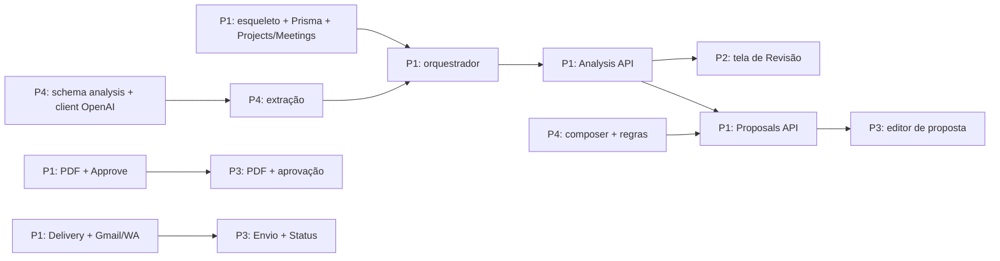

# Roadmap — Proposal AI (24 h, 4 pessoas)

Versão 1.0 · 2026-10-17 · Stack: Node/TypeScript (DECISIONS D13) · Esta é a divisão por pessoa **adotada pelo time** (P1–P4: 1 backend, 2 frontends, 1 IA). [../TEAM_TASKS.md](../TEAM_TASKS.md) mantém a referência detalhada de tarefas (divisão A/B/C/D original, com integrações separadas); em caso de conflito de atribuição, vale este roadmap.

| Pessoa | Papel | Roadmap |
|--------|-------|---------|
| **P1** | Backend (API, dados, documentos, integrações) | [01-backend.md](01-backend.md) |
| **P2** | Frontend A — entrada e revisão | [02-frontend-a.md](02-frontend-a.md) |
| **P3** | Frontend B — proposta, aprovação e envio | [03-frontend-b.md](03-frontend-b.md) |
| **P4** | IA — pipeline, estimativas e dados de exemplo | [04-ia.md](04-ia.md) |

Legenda: **P0** essencial · **P1** se der tempo · ⛓ depende de · ✅ pronto quando.

## 1. Funcionalidades e responsáveis

| # | Funcionalidade | Backend | Front A | Front B | IA |
|---|----------------|:-------:|:-------:|:-------:|:--:|
| F1 | Criar e listar projetos (cliente) | ● | ● | | |
| F2 | Enviar reunião por texto colado | ● | ● | | |
| F3 | Enviar reunião por áudio + transcrição | ● | ● | | ● |
| F4 | Extração estruturada (necessidades, requisitos, decisões, compromissos, pendências, sugestões) com citação | ● | | | ● |
| F5 | Auditoria de lacunas e contradições | ● | | | ● |
| F6 | Revisão humana item a item (confirmar/editar/rejeitar/esclarecer) | ● | ● | | |
| F7 | Rastreabilidade: ver trecho da transcrição de cada item | ● | ● | | ● |
| F8 | Estimativas determinísticas (horas, equipe, cronograma) | ● | | | ● |
| F9 | Geração da proposta (16 seções) com texto redigido pela IA | ● | | ● | ● |
| F10 | Edição e versionamento imutável da proposta | ● | | ● | |
| F11 | PDF da versão | ● | | ● | |
| F12 | Aprovação explícita com hash | ● | | ● | |
| F13 | Autorização de envio + idempotência | ● | | ● | |
| F14 | Envio Gmail (OAuth) | ● | | ● | |
| F15 | Envio WhatsApp (ou fallback `wa.me`) | ● | | ● | |
| F16 | Status independente por canal + falha isolada | ● | | ● | |
| F17 | Usuário demo (`X-Demo-User`) e configurações | ● | ● | ● | |
| F18 | Timeline de eventos (P1) | ● | ● | | |
| F19 | Testes de IA, E2E e roteiro da demo | ● | | | ● |

● = participa · primeira coluna marcada com dono em cada roadmap individual.

## 2. Regras do jogo

1. **Contratos primeiro (até H+2).** Schemas Zod em `shared/` + JSONs em `docs/examples/`. Frontends trabalham com mocks (`NEXT_PUBLIC_USE_MOCKS`) até o endpoint existir; backend usa `analysis.example.json` até a IA entregar.
2. **Trunk-based.** `main` sempre sobe com `docker compose up`. Commits pequenos.
3. **Caminho feliz antes de robustez:** texto de ponta a ponta (H+10); depois áudio, PDF bonito, Gmail, falhas.
4. **Checkpoints** H+2, 6, 10, 14, 18, 22 (15 min, em pé).
5. **Congelamento H+22:** só bug crítico e ensaio.
6. **Sem conflito de pastas:** cada pessoa só edita as suas (tabela abaixo). Mudou contrato → avisar no canal e commitar o doc **antes** do código.

| Pessoa | Pastas |
|--------|--------|
| P1 | `backend/src/{api,core,domain,repositories,config}`, `backend/prisma`, `services/{proposal,pdf,delivery,estimation/engine}`, `integrations/{gmail,whatsapp}`, `templates/`, `shared/` (exceto analysis), docker, `.env.example` |
| P2 | `frontend/` (setup, `app/` de projeto/reunião/análise, `features/{projects,meetings,analysis}`, `services/api.ts`, `lib/`) |
| P3 | `frontend/` (`app/` de proposta/envio/config, `features/{proposals,deliveries}`) |
| P4 | `services/{transcription,aiAnalysis}`, `services/proposal/composer.ts`, `services/estimation/rules.ts`, `integrations/openai`, `shared/schemas/analysis.ts`, `sample_data/`, `scripts/`, `tests/ai` |

## 3. Marcos

| Hora | Marco | Verificação |
|------|-------|-------------|
| **H+2** | Contratos congelados | Schemas Zod + exemplos validam; API sobe com `/health`; front sobe com mocks |
| **H+6** | Primeira análise real | Transcrição de exemplo → `MeetingAnalysis` válido via API; decisão go/no-go WhatsApp |
| **H+10** | Jornada vertical v0 (texto) | UI: criar projeto → colar transcrição → ver análise → revisar → concluir |
| **H+14** | Proposta gerada | API gera `ProposalContent` com estimativas; HTML renderiza; áudio transcreve |
| **H+18** | Jornada completa v1 | UI: proposta → v2 → PDF → aprovar → autorizar envio |
| **H+20** | Envio real | Gmail entrega PDF; WhatsApp real ou fallback honesto; `FORCE_FAIL` mostra falha isolada |
| **H+22** | Congelamento | Seeds, ensaio 1 |
| **H+23** | Ensaio 2 cronometrado | Backup em vídeo, PDF e prints |

## 4. Caminho crítico e dependências entre pessoas

**Caminho crítico:** extração (P4) → orquestrador (P1) → Analysis API → Proposals API → Approve → Delivery → E2E. Atraso na extração não bloqueia os frontends (mocks).

## 5. Contingência (resumo)

| Se até… | …não aconteceu | Então |
|---------|----------------|-------|
| H+3 | Structured outputs indisponíveis | `json_object` + validação Zod + repair |
| H+6 | Extração < 80% do gabarito | Aceitar 60%; nada falso-positivo vira `confirmed` |
| H+6 | WhatsApp real inviável | Fallback `skipped_no_credentials` + `wa.me` |
| H+8 | Áudio instável | Demo com texto; áudio só se funcionar no ensaio |
| H+12 | Gmail OAuth falha | `smtpAdapter` com app password |
| H+14 | Playwright falha no container | Backend fora do Docker na demo |
| H+16 | Editor da proposta atrasado | Só sumário, escopo, premissas e próximos passos editáveis |
| H+18 | Jornada não fecha na UI | Demo híbrida: UI até a revisão; resto via API |

Plano completo: [../TEAM_TASKS.md §7](../TEAM_TASKS.md).
